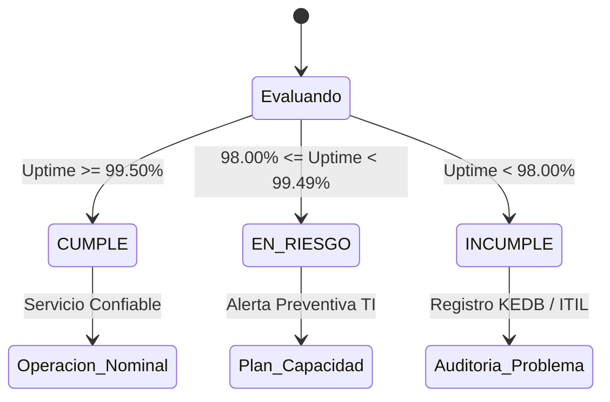
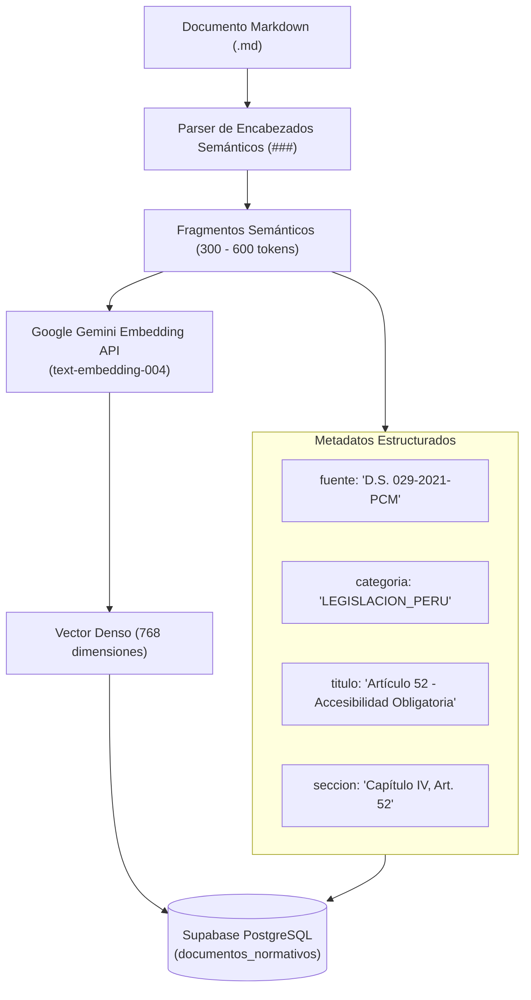

# Acuerdos de Nivel de Servicio (SLAs) y Criterios de la Base de Conocimiento

> **Proyecto:** Observatorio de Calidad Digital Pública del Perú  
> **Asignatura:** Gestión de Servicios de Tecnologías de la Información (GSTI)  
> **Institución:** Universidad Nacional de San Agustín de Arequipa (UNSA)  
> **Estándares de Referencia:** ITIL v4 (*Service Level Management*), ISO/IEC 25010 (*SQuaRE*), W3C WCAG 2.1 AA, Google Core Web Vitals  
> **Marco Legal:** D.L. N° 1412, D.S. N° 029-2021-PCM, R.SGTD N° 001-2025-PCM/SGTD  

---

## 1. Propósito y Alcance del Documento

El presente documento formaliza los **Acuerdos de Nivel de Servicio (SLA - Service Level Agreements)** operacionalizados en el Observatorio de Calidad Digital Pública del Perú, así como los **criterios metodológicos y técnicos** empleados para la selección, estructuración e indexación del corpus normativo en la base de conocimientos vectorial del sistema RAG (*Retrieval-Augmented Generation*).

Bajo las directrices de la práctica de **Service Level Management (SLM)** de **ITIL v4**, este instrumento define las metas cuantitativas de servicio, los umbrales de degradación e indisponibilidad, la taxonomía de incidentes, el tiempo medio de recuperación (MTTR) y la justificación jurídica/técnica de cada fuente documental integrada en la plataforma.

---

## 2. Acuerdos de Nivel de Servicio (SLAs) Implementados Actualmente

El sistema supervisa de manera continua e ininterrumpida los portales web de **90 entidades públicas del Estado Peruano** (19 Ministerios, 26 Gobiernos Regionales, 25 Municipalidades Provinciales y 20 Organismos Autónomos/Reguladores).

### 2.1. SLA de Disponibilidad Mensual (Uptime Normativo)

| Parámetro | Valor Objetivo | Base Jurídica / Técnica |
| :--- | :--- | :--- |
| **Meta de Disponibilidad (Uptime)** | $\ge 99.50\%$ mensual continuo ($24\times7$) | Directiva R.SGTD N° 001-2025-PCM/SGTD Art. 12 / D.S. 029-2021-PCM |
| **Indisponibilidad Máxima Permitida** | $0.50\%$ mensual $\approx$ **3.6 horas/mes** (216 minutos) | Cálculo estándar sobre período de 30 días calendario (43,200 min) |
| **Frecuencia de Evaluación** | Auditoría diaria automatizada a las 15:10 PET (20:10 UTC) | Ventana vespertina de cierre administrativo público |

#### Fórmula de Cálculo del Uptime Mensual
$$\text{Uptime Mensual (\%)} = \left( \frac{\text{Mediciones Exitosas}}{\text{Total de Mediciones del Período}} \right) \times 100 = \left( 1 - \frac{\text{Minutos de Indisponibilidad}}{43,200\text{ min}} \right) \times 100$$

### 2.2. Taxonomía de Estados de Cumplimiento de SLA (ITIL v4)

Cada mes calendario, el motor de evaluación (`sla-evaluator.ts`) asigna automáticamente uno de tres estados a cada entidad pública:



1. **`CUMPLE` (Verde / Conforme):**
   - **Condición:** Uptime acumulado en el mes $\ge 99.50\%$.
   - **Significado ITIL:** Nivel de servicio dentro de los límites contractuales. Indica resiliencia de infraestructura y procesos maduros de operación.
2. **`EN_RIESGO` (Amarillo / Advertencia):**
   - **Condición:** Uptime acumulado entre $98.00\%$ y $99.49\%$.
   - **Significado ITIL:** La entidad ha registrado caídas esporádicas o microcortes repetidos. Se encuentra a menos de 1 falla de violar el SLA. Requiere revisión de logs de capacidad por el área de TI.
3. **`INCUMPLE` (Rojo / Crítico):**
   - **Condición:** Uptime acumulado $< 98.00\%$.
   - **Significado ITIL:** Brecha grave del nivel de servicio pactado (> 2 días de caída acumulada). Constituye vulneración directa del mandato de continuidad de servicios esenciales al ciudadano (D.S. 029-2021-PCM). Activa la apertura de un registro de **Problema ITIL** para investigación de causa raíz en la KEDB (*Known Error Database*).

---

### 2.3. SLAs de Rendimiento y Experiencia de Usuario (Core Web Vitals)

El rendimiento no solo se mide como "encendido/apagado", sino por la velocidad con la que un ciudadano con conectividad móvil modesta puede acceder a la información:

| Métrica | Meta Excelente (Bueno) | Umbral Aceptable (Mejora) | Límite Crítico (Pobre) | Impacto Ciudadano |
| :--- | :--- | :--- | :--- | :--- |
| **TTFB (Time to First Byte)** | $\le 800\text{ ms}$ | $801\text{ ms} - 1,800\text{ ms}$ | $> 2,000\text{ ms}$ | Tiempo de respuesta inicial del servidor/gateway |
| **LCP (Largest Contentful Paint)** | $\le 2.5\text{ s}$ | $2.5\text{ s} - 4.0\text{ s}$ | $> 4.0\text{ s}$ | Renderizado del contenido visual principal |
| **CLS (Cumulative Layout Shift)** | $\le 0.10$ | $0.11 - 0.25$ | $> 0.25$ | Estabilidad visual; evita clics accidentales |
| **INP (Interaction to Next Paint)** | $\le 200\text{ ms}$ | $201\text{ ms} - 500\text{ ms}$ | $> 500\text{ ms}$ | Capacidad de respuesta ante clics y teclas |
| **FCP (First Contentful Paint)** | $\le 1.8\text{ s}$ | $1.9\text{ s} - 3.0\text{ s}$ | $> 3.0\text{ s}$ | Primer indicio visual de carga para el usuario |

> **Umbral de Degradación Severa de Conectividad:**  
> Si el TTFB o tiempo de respuesta supera los **$8,000\text{ ms}$ (8 segundos)** o la conexión se agota a los **$10,000\text{ ms}$ (timeout)**, la medición se clasifica formalmente como evento de falla e indisponibilidad técnica, pues un portal estatal inutilizable en la práctica equivale a una caída de servicio.

---

### 2.4. SLA de Accesibilidad e Inclusión Web (W3C WCAG 2.1 AA)

| Parámetro | Criterio de Aceptación | Severidad de Infracción |
| :--- | :--- | :--- |
| **Puntaje Mínimo de Accesibilidad** | $\ge 80.0\%$ (Lighthouse Accessibility Audit) | Infracciones menores toleradas si no bloquean la navegación |
| **Infracciones Críticas Toleradas** | **0 infracciones** | Violaciones de contraste $< 3:1$, falta total de atributos `alt` en imágenes esenciales o ausencia de foco accesible |
| **Cumplimiento Legal** | D.S. N° 029-2021-PCM Art. 52 y Ley N° 29973 | Obligatoriedad legal de diseño universal para personas con discapacidad visual, auditiva o motriz |

---

### 2.5. Gestión de Incidentes ITIL v4 y Meta de MTTR

El observatorio detecta y agrupa eventos de falla en episodios de incidentes bajo cuatro categorías de severidad:

1. **`CAIDA_TOTAL` (Severidad CRÍTICA):** Error HTTP 5xx (`500 Internal Server Error`, `502 Bad Gateway`, `503 Service Unavailable`), fallo de resolución DNS (`ENOTFOUND`) o caída total del host.
2. **`ERROR_SSL` (Severidad CRÍTICA):** Certificado digital TLS/HTTPS vencido, revocado o mal configurado, impidiendo el acceso cifrado seguro de los navegadores.
3. **`BLOQUEO_WAF` (Severidad ALTA):** Código HTTP 403 Forbidden que bloquea arbitrariamente a ciudadanos o herramientas de monitoreo.
4. **`DEGRADACION_SEVERA` (Severidad ALTA / MEDIA):** Latencias superiores a 8,000 ms por saturación de base de datos o sobrecarga de backend.

#### Métrica de MTTR (Mean Time to Resolution)
- **Meta ITIL v4:** $\text{MTTR} \le 60\text{ minutos}$ para servicios críticos de alta demanda ciudadana.
- **Cálculo Dinámico:**
  $$\text{MTTR} = \frac{\sum_{i=1}^{N_{\text{resueltos}}} (\text{Timestamp Resolución}_i - \text{Timestamp Inicio}_i)}{N_{\text{resueltos}}}$$

---

### 2.6. Ponderación Multidimensional ISO/IEC 25010 (Score Global 0-100)

Para consolidar el Ranking Nacional de Calidad Digital, el sistema implementa un modelo de calidad de producto de software alineado a la norma **ISO/IEC 25010 (SQuaRE)** con la ponderación **40 / 30 / 30**:

$$\text{Score Global} = (0.40 \times \text{Disponibilidad}) + (0.30 \times \text{Rendimiento}) + (0.30 \times \text{Accesibilidad})$$

```
                   PUNTAJE GLOBAL DE CALIDAD DIGITAL (100%)
                                      │
         ┌────────────────────────────┼────────────────────────────┐
         ▼                            ▼                            ▼
   CONFIABILIDAD (40%)       EFICIENCIA DESEMPEÑO (30%)    ACCESIBILIDAD (30%)
 ───────────────────────     ──────────────────────────    ────────────────────
 • Uptime mensual real       • Largest Contentful Paint    • WCAG 2.1 Nivel AA
 • Latencia TTFB (<800ms)    • Cumulative Layout Shift     • Contraste de Color
 • Ausencia de Caídas        • Speed Index / FCP           • Semántica HTML / ARIA
```

* **Justificación del 40% a la Disponibilidad:** Es el habilitador primordial del servicio público. Si el portal está caído, las otras dimensiones carecen de efecto.
* **Justificación del 30% al Rendimiento:** Determina la equidad de acceso en el territorio nacional, donde gran parte de la población accede mediante redes móviles de banda angosta.
* **Justificación del 30% a la Accesibilidad:** Responde al principio constitucional de no discriminación y al cumplimiento estricto del marco normativo peruano de inclusión.

---

## 3. Criterios de Selección y Curaduría de la Base de Conocimiento (RAG)

El subsistema **Auditor IA con RAG** (*SDD-MOD-005*) tiene la función de asesorar a ciudadanos, funcionarios públicos y auditores técnicos con fundamentación jurídica y técnica sólida, eliminando alucinaciones mediante la técnica *Grounding* contra un corpus de fuentes oficiales primarias.

### 3.1. Criterios Metodológicos de Selección de Documentos

Para la conformación de la base de conocimiento se establecieron **cuatro criterios de inclusión estrictos**:

1. **Oficialidad y Vinculatoriedad Jurídica (Fuentes Primarias):** Se excluyeron blogs, interpretaciones informales o artículos de opinión. Solo se incorporaron normas publicadas en el Diario Oficial *El Peruano*, resoluciones de la Secretaría de Gobierno y Transformación Digital (SGTD-PCM) y recomendaciones de organismos oficiales internacionales (W3C, AXELOS, ISO).
2. **Aplicabilidad Directa a Portales Digitales del Estado:** Los documentos seleccionados regulan de manera directa la disponibilidad, el diseño, la accesibilidad y la continuidad operativa de los servicios web del Estado Peruano.
3. **Capacidad Prescriptiva de Remediación Técnica:** El corpus no solo contiene mandatos teóricos, sino directrices técnicas accionables (selectores CSS, atributos ARIA, directivas de compresión Brotli, headers HTTP de caché) que permiten al agente sugerir código correctivo a los desarrolladores de las entidades.
4. **Complementariedad Integral:** Se cubren los tres ejes indispensables: Marco Legal Peruano, Estándares Técnicos de la Web e Ingeniería de Gestión de Servicios de TI (ITIL).

---

### 3.2. Catálogo Oficial del Corpus Documental

A continuación se detalla cada uno de los 5 documentos curados en [`docs/knowledge_base/`](file:///home/tooboe/Documentos/AcademicProjects/GSTI_project/docs/knowledge_base/):

#### 1. `01_ley_gobierno_digital_dl1412.md` — Marco Jurídico Fundacional
* **Fuente Oficial:** Decreto Legislativo N° 1412, Presidencia de la República (El Peruano, 2018).
* **Categoría RAG:** `LEGISLACION_PERU`.
* **Criterio de Selección:** Es la norma madre que rige el Gobierno Digital en el Perú.
* **Contenido Esencial Curado:**
  * *Artículo 4.1:* Obligación estatal de proveer servicios digitales confiables, seguros, accesibles e interoperables.
  * *Artículo 5 (5.5, 5.6, 5.9, 5.10):* Principios rectores de neutralidad tecnológica, orientación al ciudadano, accesibilidad universal y apertura de datos públicos.
  * *Artículo 8:* Rol rector, normativo y supervisor de la PCM a través de la SGTD.
  * *Artículo 18:* Garantías legales de disponibilidad ininterrumpida de información pública.

#### 2. `02_reglamento_gobierno_digital_ds029_2021_pcm.md` — Reglamento Operativo y Plazos
* **Fuente Oficial:** D.S. N° 029-2021-PCM, modificado por D.S. N° 085-2023-PCM y R.SGTD N° 001-2025-PCM/SGTD.
* **Categoría RAG:** `LEGISLACION_PERU`.
* **Criterio de Selección:** Establece las reglas operativas, obligaciones específicas y plazos perentorios de cumplimiento para las entidades públicas.
* **Contenido Esencial Curado:**
  * *Artículo 52:* Obligatoriedad del cumplimiento de pautas de accesibilidad web WCAG en todas las sedes digitales del Estado.
  * *Disposiciones Transitorias:* Plazo de 12 meses para adecuación total en Ministerios y Gobiernos Regionales.
  * *R.SGTD 001-2025:* Estándares obligatorios para canales de atención digital (mesa de partes virtual operativa $24\times7$, uso forzoso de certificados TLS/HTTPS y disponibilidad de servicios esenciales).

#### 3. `03_estandares_accesibilidad_wcag21_remediacion.md` — Estándar Técnico de Accesibilidad
* **Fuente Oficial:** World Wide Web Consortium (W3C), *Web Content Accessibility Guidelines (WCAG) 2.1 nivel AA*.
* **Categoría RAG:** `ACCESIBILIDAD_WCAG`.
* **Criterio de Selección:** Es el estándar internacional explícitamente adoptado por la legislación peruana para auditar y remediar barreras digitales.
* **Contenido Esencial Curado:**
  * *Criterio 1.1.1 (Contenido no textual):* Reglas para textos alternativos descriptivos (`alt`) en imágenes funcionales e institucionales.
  * *Criterio 1.4.3 (Contraste mínimo):* Ratio de contraste de color $\ge 4.5:1$ para texto normal y $\ge 3:1$ para texto grande o componentes de UI.
  * *Criterio 2.1.1 (Teclado):* Operabilidad completa sin depender exclusivamente del mouse.
  * *Criterio 2.4.7 (Foco visible):* Indicador visual visible al navegar mediante la tecla `Tab` (eliminación de `outline: none`).
  * *Criterio 4.1.2 (Nombre, función, valor):* Marcado semántico y atributos ARIA (`aria-label`, `role`) para lectores de pantalla.

#### 4. `04_metricas_core_web_vitals_remediacion.md` — Estándar de Eficiencia de Rendimiento
* **Fuente Oficial:** Google Chrome Web Performance Team & W3C Web Performance Working Group.
* **Categoría RAG:** `RENDIMIENTO_CWV`.
* **Criterio de Selección:** Provee la base científica y las fórmulas cuantitativas que utiliza Lighthouse para evaluar la experiencia de carga de los portales.
* **Contenido Esencial Curado:**
  * Umbrales cuantitativos exactos de LCP, CLS, TTFB, FCP e INP.
  * Diagnóstico de cuellos de botella: bloqueo del hilo principal de JavaScript, imágenes pesadas sin compresión, fuentes web sin `font-display: swap`.
  * Prescripciones técnicas: Implementación de WebP/AVIF, directivas `fetchpriority="high"`, compresión Brotli/Gzip y uso de CDNs.

#### 5. `05_gestion_servicios_itil_slas.md` — Marco de Gobernanza GSTI
* **Fuente Oficial:** AXELOS, *ITIL 4 Foundation: ITIL 4 Edition* / ISO/IEC 25010 *SQuaRE*.
* **Categoría RAG:** `GESTION_ITIL`.
* **Criterio de Selección:** Articula la base conceptual del curso GSTI, formalizando cómo transformar métricas de red en decisiones de gestión de servicios.
* **Contenido Esencial Curado:**
  * Gestión de Eventos y Monitoreo: Taxonomía de eventos Informativos, de Advertencia y de Excepción.
  * Gestión de Incidentes: Incidentes transitorios vs. crónicos y ciclo de vida de remediación.
  * Service Level Management: Definición de SLA, OLA y contratos de soporte (UC).
  * Fórmulas de disponibilidad y cálculo de multas/penalizaciones operacionales por incumplimiento de niveles de servicio.

---

### 3.3. Criterios de Segmentación (Chunking) y Metadatos para pgvector

Para garantizar una recuperación vectorial de alta precisión sin pérdida de contexto jurídico, se implementaron los siguientes criterios técnicos:



1. **Segmentación por Fronteras Semánticas (Semantic Boundary Chunking):**  
   En lugar de dividir el texto por conteo ciego de caracteres, los fragmentos se dividen estrictamente en función de la estructura lógica de los documentos (encabezados de nivel 3 `###`, artículos de leyes o criterios técnicos WCAG). Esto evita que un artículo legal quede truncado a la mitad de su parte resolutiva.
2. **Tamaño Óptimo de Chunk (300 a 600 tokens):**  
   Permite encapsular el mandado legal o técnico completo junto con su fundamento, optimizando la capacidad del vector para representar el significado denso sin diluir la semántica.
3. **Indexación HNSW con Métrica Coseno:**  
   Se utiliza un índice HNSW (*Hierarchical Navigable Small World*) con $m=16$ y $ef\_construction=64$ sobre la tabla `documentos_normativos`, logrando búsquedas vectoriales con similitud coseno ($1 - \text{distancia}$) en menos de $20\text{ ms}$.

---

### 3.4. Mecanismo de Consulta Híbrida del Agente RAG

El sistema no utiliza un enfoque RAG meramente textual, sino una **arquitectura híbrida de orquestación dual**:

1. **`execute_telemetry_sql` (Tool SQL Estricto):**  
   Cuando la consulta ciudadana o técnica incluye preguntas cuantitativas sobre una o más entidades (*"¿Qué entidades incumplen su SLA este mes?"* o *"¿Cuál es el LCP del Ministerio de Salud?"*), el agente ejecuta sentencias SQL `SELECT` de solo lectura contra las tablas relacionales de telemetría (`entidades`, `mediciones_crudas`, `evaluaciones_sla`, `incidentes`).
2. **`search_normative_base` (Tool Vectorial pgvector):**  
   Cuando la consulta indaga sobre el fundamento legal o las técnicas de remediación (*"¿Qué norma peruana sanciona el incumplimiento de accesibilidad?"* o *"¿Cómo resuelvo la falta de contraste en botones?"*), el agente recupera los fragmentos semánticos más cercanos del corpus vectorial.
3. **Síntesis Fundamentada (Grounding):**  
   El modelo Gemini 2.5 Flash combina ambos resultados en una respuesta estructurada, citando la norma exacta y contrastándola con la evidencia empírica real de la base de datos.

---

*Documento técnico y normativo aprobado para el Observatorio de Calidad Digital Pública del Perú — Universidad Nacional de San Agustín de Arequipa (UNSA).*
