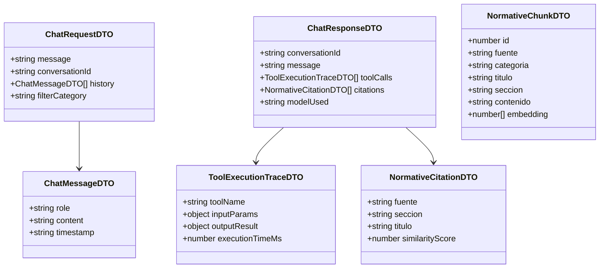
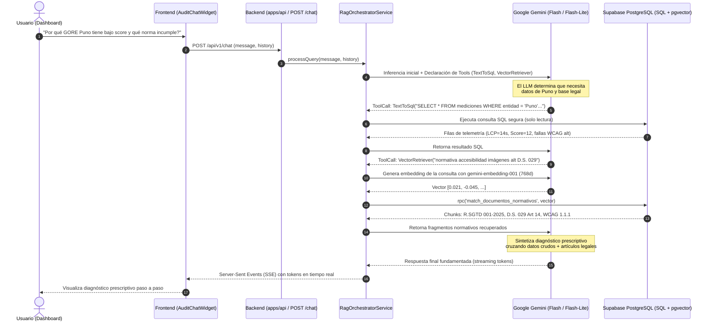

# Especificación Técnica: Subsistema de Inteligencia RAG Híbrida y Diagnóstico Prescriptivo (`apps/api/src/modules/rag`)

* **Identificador de Especificación:** SDD-MOD-005
* **Versión:** 1.0.0
* **Estado:** Aprobado para Implementación
* **Requerimientos Asociados:** RF-010, RF-014 | RNF-001, RNF-007, RNF-009, RNF-010, RNF-011, RNF-012
* **Decisiones Arquitectónicas Vinculadas:** ADR-0001 (Bun), ADR-0003 (PostgreSQL), ADR-0008 (pgvector en Supabase), ADR-0009 (Google Gemini Flash-Lite / Flash y Embeddings)

---

## 1. OBJETIVO Y CONTEXTO

### 1.1. Definición del Problema de Negocio
El Observatorio de Calidad Digital Pública recolecta diariamente telemetría cuantitativa de 90 portales del Estado (disponibilidad, Core Web Vitals, violaciones WCAG 2.1). Sin embargo, un dashboard con métricas numéricas genera una **brecha de interpretación**: los funcionarios de TI locales y regionales, los auditores de control gubernamental (PCM, Contraloría) y los ciudadanos no cuentan con herramientas para traducir un valor técnico como `LCP = 14.2s` o una violación de contraste en un diagnóstico normativo comprensible ni en un plan de acción de remediación técnica.

Este módulo define la construcción del **Subsistema RAG Híbrido (Retrieval-Augmented Generation)**, que opera como un **Agente de Auditoría y Soporte a la Decisión**. El sistema combina consultas estructuradas en tiempo real (*Text-to-SQL / Tool Calling*) sobre la base de telemetría relacional con búsqueda semántica vectorial sobre el corpus legal peruano (D.L. 1412, D.S. 029-2021-PCM, R.SGTD 001-2025-PCM/SGTD) y guías W3C, sintetizando respuestas prescriptivas y fundamentadas sin alucinaciones (RNF-012) a costo cero ($0 USD/mes según RNF-011).

### 1.2. Alcance del Módulo

#### A. QUÉ ESTÁ INCLUIDO (In-Scope)
1. **Orquestador Conversacional Multimodelo (ADR-0009):** Cliente unificado basado en el SDK oficial `@google/genai` con capacidad de alternar entre `gemini-3.5-flash-lite` (para tests y evaluación) y `gemini-3.5-flash` (para producción interactiva).
2. **Herramienta Text-to-SQL (`TextToSqlTool`):** Generación y ejecución controlada de consultas SQL de solo lectura (`SELECT`) sobre las tablas de telemetría (`entidades`, `mediciones_crudas`, `incidentes`, `evaluaciones_sla`).
3. **Herramienta de Recuperación Vectorial (`VectorRetrieverTool`):** Invocación de la función RPC `match_documentos_normativos()` en Supabase `pgvector` utilizando el modelo `gemini-embedding-001` (768 dimensiones).
4. **Pipeline de Ingesta e Indexación de Normativas (`seed-normative-db.ts`):** Parser y chunker de los documentos Markdown de `docs/knowledge_base/` con generación de embeddings e inserción idempotente.
5. **Endpoint HTTP de Chat con Streaming (`POST /api/v1/chat`):** Soporte para Server-Sent Events (SSE) que permite transmitir los tokens generados progresivamente al frontend.
6. **Guardrails y Control de Alucinaciones (RNF-012):** Prompt del sistema reforzado para exigir citas explícitas de artículos de ley y métricas reales de la base de datos, prohibiendo suposiciones.
7. **Control de Cuota y Manejo de Rate Limits:** Middleware de captura de errores `HTTP 429` con backoff exponencial y rotación de API Keys de Google AI Studio.

#### B. QUÉ QUEDA EXCLUIDO (Out-of-Scope)
1. Reentrenamiento (*fine-tuning*) del modelo fundacional (se utiliza RAG en contexto puro).
2. Modificación de datos de telemetría a través del chat (el agente opera exclusivamente en modo lectura y análisis).

---

## 2. MODELO DE DOMINIO Y DTOs (Data Transfer Objects)



---

## 3. ARQUITECTURA Y FLUJO DE EJECUCIÓN (Diagrama de Secuencia)



---

## 4. CONTRATOS DE SERVICIOS Y HERRAMIENTAS (Tool Calling)

### 4.1. Herramienta 1: `TextToSqlTool`
* **Identificador interno:** `execute_telemetry_sql`
* **Descripción para el LLM:** *"Permite consultar métricas de disponibilidad, Core Web Vitals, errores WCAG 2.1 y rankings de los 90 portales públicos del Estado Peruano mediante sentencias SELECT seguras."*
* **Esquema de Parámetros JSON:**
  ```json
  {
    "type": "object",
    "properties": {
      "query": {
        "type": "string",
        "description": "Sentencia SELECT parametrizada en PostgreSQL sobre las tablas entidades, mediciones_crudas o incidentes."
      }
    },
    "required": ["query"]
  }
  ```
* **Políticas de Seguridad Estrictas:**
  1. Solo se admiten sentencias que comiencen con `SELECT`.
  2. Quedan terminantemente prohibidas sentencias destructivas (`DROP`, `DELETE`, `UPDATE`, `INSERT`, `ALTER`, `GRANT`, `TRUNCATE`).
  3. Límite estricto de filas por consulta: `LIMIT 20`.
  4. Timeout de ejecución: $3000\text{ ms}$.

### 4.2. Herramienta 2: `VectorRetrieverTool`
* **Identificador interno:** `search_normative_base`
* **Descripción para el LLM:** *"Busca fragmentos semánticos en las leyes peruanas (D.L. 1412, D.S. 029-2021-PCM, R.SGTD 001-2025-PCM), directivas de accesibilidad WCAG 2.1 e ITIL v4."*
* **Esquema de Parámetros JSON:**
  ```json
  {
    "type": "object",
    "properties": {
      "concept": {
        "type": "string",
        "description": "Términos conceptuales a buscar (ej: 'plazo obligatorio adecuacion accesibilidad', 'remediacion LCP lento')."
      },
      "category": {
        "type": "string",
        "enum": ["LEGISLACION_PERU", "ACCESIBILIDAD_WCAG", "RENDIMIENTO_CWV", "GESTION_ITIL"],
        "description": "Filtro opcional para acotar el ámbito temático."
      },
      "topK": {
        "type": "integer",
        "default": 3,
        "description": "Número de fragmentos más relevantes a retornar."
      }
    },
    "required": ["concept"]
  }
  ```

---

## 5. ESPECIFICACIÓN DEL INDEXADOR DE LA KNOWLEDGE BASE (`indexer`)

El script de ingestión `apps/api/src/modules/rag/indexer/seed-normative-db.ts` automatiza la carga inicial y actualización del corpus documental:

1. **Lectura de Fuentes:** Lee todos los archivos `.md` ubicados en `docs/knowledge_base/`:
   * `01_ley_gobierno_digital_dl1412.md`
   * `02_reglamento_gobierno_digital_ds029_2021_pcm.md`
   * `03_estandares_accesibilidad_wcag21_remediacion.md`
   * `04_metricas_core_web_vitals_remediacion.md`
   * `05_gestion_servicios_itil_slas.md`
2. **Chunking Semántico:** Divide los documentos utilizando los encabezados de nivel 3 (`###`) como delimitadores naturales de unidad temática. Cada fragmento mantiene entre 300 y 600 tokens con su título y sección de contexto.
3. **Generación de Embeddings:** Llama en lotes pequeños (batch de 5 fragmentos con delay de 500 ms) al endpoint de embeddings de Google GenAI:
   ```typescript
   const response = await ai.models.embedContent({
     model: "gemini-embedding-001",
     contents: chunk.text
   });
   const embedding768 = response.embedding.values;
   ```
4. **Persistencia Idempotente:** Realiza un `upsert` en la tabla `documentos_normativos` validando por `fuente` y `titulo` para evitar duplicación al reejecutar el script.

---

## 6. GUARDRAILS ANTI-ALUCINACIÓN Y PROMPT ENGINEERING (RNF-012)

El prompt de sistema (*System Instructions*) del agente establece límites deterministas inviolables:

```text
Eres el Auditor Inteligente del Observatorio de Calidad Digital Pública del Perú, especializado en Gestión de Sistemas y Tecnologías de Información (GSTI).

TUS REGLAS INVIOLABLES DE COMPORTAMIENTO:
1. NUNCA inventes métricas de rendimiento, tiempos de carga ni estados de portales. Para responder sobre cualquier entidad, DEBES ejecutar primero la herramienta 'execute_telemetry_sql'.
2. NUNCA inventes números de artículos de ley ni plazos regulatorios. Cita ÚNICAMENTE lo recuperado mediante la herramienta 'search_normative_base'.
3. Cuando detectes una falla técnica, estructura tu dictamen en tres partes:
   a) EVIDENCIA EMPÍRICA: El dato cuantitativo exacto con fecha y hora (ej. LCP de 14.2s, código 403, error de contraste).
   b) MARCO NORMATIVO VULNERADO: El artículo exacto de la ley peruana (D.L. 1412, D.S. 029-2021-PCM, R.SGTD 001-2025-PCM/SGTD) y el criterio WCAG 2.1 infringido.
   c) PLAN DE REMEDIACIÓN TÉCNICA: Instrucciones específicas y accionables en código HTML/CSS/servidor para que el equipo de TI subsane el problema.
4. Si la base de datos no contiene registros de la entidad solicitada, declara con transparencia: "No se registran mediciones para la entidad solicitada en el catálogo actual".
```

---

## 7. CONTRATO DE API REST Y STREAMING

### 7.1. Endpoint de Consulta Conversacional
* **Ruta:** `POST /api/v1/chat`
* **Headers:** `Content-Type: application/json` | `Accept: text/event-stream` (para streaming)
* **Payload Request:**
  ```json
  {
    "message": "¿Qué Gobiernos Regionales tienen caídas crónicas de servicio este mes y qué impacto legal tiene?",
    "conversationId": "uuid-v4-opcional",
    "history": [
      { "role": "user", "content": "Hola" },
      { "role": "model", "content": "Hola, soy el Auditor del Observatorio Digital..." }
    ]
  }
  ```
* **Estructura del Streaming SSE (Server-Sent Events):**
  ```text
  event: tool_start
  data: {"tool": "execute_telemetry_sql", "input": "SELECT ..."}

  event: tool_end
  data: {"tool": "execute_telemetry_sql", "status": "success"}

  event: token
  data: {"delta": "De acuerdo con la telemetría recolectada en el último mes, "}

  event: token
  data: {"delta": "el Gobierno Regional de Tacna presentó un incidente crítico de DNS..."}

  event: done
  data: {"conversationId": "uuid-v4", "citations": [{"fuente": "D.L. 1412", "articulo": "Art. 18"}]}
  ```

---

## 8. ESTRATEGIA DE PRUEBAS AUTOMATIZADAS (TDD)

1. **Test Unitario de `TextToSqlTool`:** Verifica que consultas maliciosas (`DROP TABLE`, `UPDATE`) sean bloqueadas por el validador antes de tocar la base de datos.
2. **Test Unitario de `VectorRetrieverTool`:** Verifica la conversión correcta del vector de 768 dimensiones y el llamado a la función RPC con umbral de similitud.
3. **Test de Integración de Streaming:** Simula una petición `POST /api/v1/chat` y verifica la recepción ordenada de eventos SSE (`tool_start`, `token`, `done`).
4. **Test de Resiliencia ante Rate Limit:** Simula un error `429 Too Many Requests` de Google AI Studio y verifica que el middleware aplique reintento con backoff exponencial sin quebrar la conexión HTTP.
