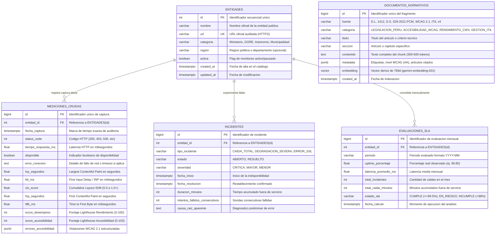

# Especificación Técnica: Persistencia Relacional y Vectorial en Supabase PostgreSQL (`supabase/database`)

* **Identificador de Especificación:** SDD-MOD-006
* **Versión:** 1.0.0
* **Estado:** Aprobado para Implementación
* **Requerimientos Asociados:** RF-001, RF-002, RF-003, RF-004, RF-005, RF-009, RF-012, RF-014 | RNF-001, RNF-003, RNF-004, RNF-005, RNF-008, RNF-011, RNF-012
* **Decisiones Arquitectónicas Vinculadas:** ADR-0003 (PostgreSQL en Supabase), ADR-0008 (pgvector en Supabase), ADR-0009 (Google Gemini Flash-Lite / Flash y Embeddings)

---

## 1. OBJETIVO Y CONTEXTO

### 1.1. Definición del Problema de Negocio
El Observatorio de Calidad Digital Pública requiere una capa de persistencia unificada, transaccional y de alto rendimiento que actúe como **Fuente Única de Verdad (Single Source of Truth)** para:
1. **Datos Cuantitativos Estructurados:** Series temporales de telemetría de red (disponibilidad HTTP, latencia) y calidad web (Core Web Vitals y auditorías WCAG 2.1) recolectadas diariamente sobre los 90 portales del Estado.
2. **Ciclo de Vida de Incidentes y SLAs:** Registro auditable de caídas de servicio, duración de indisponibilidad y evaluaciones mensuales de acuerdos de nivel de servicio (ITIL v4).
3. **Datos Semánticos No Estructurados (RAG):** Base de conocimiento legal y técnica peruana (D.L. 1412, D.S. 029-2021-PCM, R.SGTD 001-2025-PCM/SGTD, WCAG 2.1, ITIL v4) indexada en representaciones vectoriales densas de 768 dimensiones.

Todo esto debe operar bajo una política estricta de **costo operativo cero ($0 USD/mes, RNF-011)** aprovechando el nivel gratuito de Supabase (500 MB de almacenamiento), con tiempos de consulta inferiores a 100 ms (RNF-001) y resguardo riguroso de integridad de datos.

### 1.2. Gobernanza de Cuota y Presupuesto de Almacenamiento (RNF-011)

| Tabla / Componente | Registros Proyectados (1 Año) | Tamaño Promedio / Registro | Almacenamiento Estimado |
| :--- | :---: | :---: | :---: |
| `entidades` | 90 registros | ~1 KB | ~0.1 MB |
| `mediciones_crudas` | 90 entidades × 365 días = 32,850 | ~1.2 KB (incluyendo JSONB) | ~39.4 MB |
| `incidentes` | ~150 incidentes/año | ~1 KB | ~0.2 MB |
| `evaluaciones_sla` | 90 entidades × 12 meses = 1,080 | ~0.5 KB | ~0.5 MB |
| `documentos_normativos` | ~500 chunks normativos | ~4 KB (texto + vector 768 float32) | ~2.0 MB |
| Índices B-Tree + HNSW | Todos los índices activos | — | ~12.0 MB |
| **TOTAL PROYECTADO (1 AÑO)** | **—** | **—** | **~54.2 MB (< 11% de la cuota de 500 MB)** |

> [!IMPORTANT]
> **Prevención de Pausa por Inactividad:** La política de Supabase de pausar proyectos tras 7 días de inactividad en el Free Tier queda mitigada de manera natural porque el colector autónomo (`packages/collector`) se ejecuta diariamente a las 15:10 PET mediante GitHub Actions (`daily-audit.yml`), garantizando actividad transaccional continua los 365 días del año.

### 1.3. Alcance del Módulo

#### A. QUÉ ESTÁ INCLUIDO (In-Scope)
1. **Esquema Relacional Integral:** Definición DDL formal de tablas: `entidades`, `mediciones_crudas`, `incidentes`, `evaluaciones_sla` y `documentos_normativos`.
2. **Extensión Vectorial `pgvector`:** Habilitación de tipos de datos `vector(768)` para el modelo `gemini-embedding-001` (ADR-0008, ADR-0009).
3. **Índice HNSW (Hierarchical Navigable Small World):** Indexación de alta velocidad para búsqueda de similitud coseno (`vector_cosine_ops`) con parámetros $m=16, ef\_construction=64$.
4. **Procedimiento Almacenado / RPC:** Función `match_documentos_normativos()` invocable mediante cliente Supabase para recuperación semántica en el subsistema RAG (SDD-MOD-005).
5. **Índices de Cobertura Relacional:** B-Trees optimizados para consultas en tiempo real de rankings (`score_global`), filtros por categoría/región y series temporales por rango de fechas (RNF-001).
6. **Seguridad y Políticas de Acceso (RLS):** Activación de Row Level Security garantizando lectura pública anónima de métricas y restringiendo la inserción/mutación exclusivamente a credenciales `service_role`.

#### B. QUÉ QUEDA EXCLUIDO (Out-of-Scope)
1. Lógica de sondeo HTTP o conexión con la API de Google PageSpeed (responsabilidad de SDD-MOD-001).
2. Síntesis y streaming de lenguaje natural (responsabilidad de SDD-MOD-005).
3. Lógica de cálculo matemático del motor analítico (responsabilidad de SDD-MOD-002).

---

## 2. MODELO ENTIDAD-RELACIÓN UNIFICADO (Mermaid ERD)



---

## 3. DICCIONARIO DE DATOS Y ESPECIFICACIÓN DDL

### 3.1. Extensión Vectorial y Tipos
```sql
-- Habilitar extension pgvector nativa
CREATE EXTENSION IF NOT EXISTS vector;
```

### 3.2. Tabla: `entidades`
Representa el catálogo oficial de los 90 portales del Estado monitoreados.
* `id`: `SERIAL PRIMARY KEY`
* `nombre`: `VARCHAR(255) NOT NULL`
* `url`: `VARCHAR(500) NOT NULL UNIQUE`
* `categoria`: `VARCHAR(50) NOT NULL CHECK (categoria IN ('Ministerio', 'GORE', 'Organismo Autónomo', 'Municipalidad Provincial'))`
* `region`: `VARCHAR(100)` (Opcional, obligatorio para GOREs y Municipalidades)
* `activa`: `BOOLEAN NOT NULL DEFAULT true`
* `created_at`: `TIMESTAMPTZ NOT NULL DEFAULT CURRENT_TIMESTAMP`
* `updated_at`: `TIMESTAMPTZ NOT NULL DEFAULT CURRENT_TIMESTAMP`

### 3.3. Tabla: `mediciones_crudas`
Serie temporal de telemetría inmutable capturada diariamente.
* `id`: `BIGSERIAL PRIMARY KEY`
* `entidad_id`: `INTEGER NOT NULL REFERENCES entidades(id) ON DELETE CASCADE`
* `fecha_captura`: `TIMESTAMPTZ NOT NULL DEFAULT CURRENT_TIMESTAMP`
* `status_code`: `INTEGER NOT NULL`
* `tiempo_respuesta_ms`: `FLOAT NOT NULL`
* `disponible`: `BOOLEAN NOT NULL`
* `error_conexion`: `TEXT`
* `lcp_segundos`: `FLOAT`
* `fid_ms`: `FLOAT`
* `cls_score`: `FLOAT`
* `fcp_segundos`: `FLOAT`
* `ttfb_ms`: `FLOAT`
* `score_desempeno`: `INTEGER CHECK (score_desempeno BETWEEN 0 AND 100)`
* `score_accesibilidad`: `INTEGER CHECK (score_accesibilidad BETWEEN 0 AND 100)`
* `errores_accesibilidad`: `JSONB DEFAULT '[]'::jsonb`

### 3.4. Tabla: `incidentes`
Registro del ciclo de vida de incidentes de disponibilidad según ITIL v4.
* `id`: `BIGSERIAL PRIMARY KEY`
* `entidad_id`: `INTEGER NOT NULL REFERENCES entidades(id) ON DELETE CASCADE`
* `tipo_incidente`: `VARCHAR(50) NOT NULL`
* `estado`: `VARCHAR(20) NOT NULL CHECK (estado IN ('ABIERTO', 'RESUELTO'))`
* `severidad`: `VARCHAR(20) NOT NULL CHECK (severidad IN ('CRITICA', 'MAYOR', 'MENOR'))`
* `fecha_inicio`: `TIMESTAMPTZ NOT NULL`
* `fecha_resolucion`: `TIMESTAMPTZ`
* `duracion_minutos`: `INTEGER`
* `intentos_fallidos_consecutivos`: `INTEGER NOT NULL DEFAULT 1`
* `causa_raiz_aparente`: `TEXT`

### 3.5. Tabla: `evaluaciones_sla`
Consolidación analítica mensual de Acuerdos de Nivel de Servicio (meta: $99.5\%$).
* `id`: `BIGSERIAL PRIMARY KEY`
* `entidad_id`: `INTEGER NOT NULL REFERENCES entidades(id) ON DELETE CASCADE`
* `periodo`: `VARCHAR(7) NOT NULL` (Formato `YYYY-MM`)
* `uptime_porcentaje`: `FLOAT NOT NULL CHECK (uptime_porcentaje BETWEEN 0.0 AND 100.0)`
* `latencia_promedio_ms`: `FLOAT NOT NULL`
* `total_incidentes`: `INTEGER NOT NULL DEFAULT 0`
* `total_caida_minutos`: `INTEGER NOT NULL DEFAULT 0`
* `estado_sla`: `VARCHAR(20) NOT NULL CHECK (estado_sla IN ('CUMPLE', 'EN_RIESGO', 'INCUMPLE'))`
* `fecha_calculo`: `TIMESTAMPTZ NOT NULL DEFAULT CURRENT_TIMESTAMP`
* `UNIQUE (entidad_id, periodo)`

### 3.6. Tabla: `documentos_normativos`
Corpus documental legal peruano y técnico indexado para el agente RAG.
* `id`: `BIGSERIAL PRIMARY KEY`
* `fuente`: `VARCHAR(100) NOT NULL` (ej. `'D.L. 1412'`, `'D.S. 029-2021-PCM'`, `'R.SGTD 001-2025-PCM/SGTD'`, `'WCAG 2.1'`, `'ITIL v4'`)
* `categoria`: `VARCHAR(50) NOT NULL CHECK (categoria IN ('LEGISLACION_PERU', 'ACCESIBILIDAD_WCAG', 'RENDIMIENTO_CWV', 'GESTION_ITIL'))`
* `titulo`: `VARCHAR(255) NOT NULL`
* `seccion`: `VARCHAR(100)`
* `contenido`: `TEXT NOT NULL`
* `metadata`: `JSONB DEFAULT '{}'::jsonb`
* `embedding`: `vector(768) NOT NULL`
* `created_at`: `TIMESTAMPTZ NOT NULL DEFAULT CURRENT_TIMESTAMP`

---

## 4. ÍNDICES Y OPTIMIZACIÓN DE CONSULTAS

### 4.1. Índices Relacionales B-Tree (RNF-001)
Garantizan que las consultas de fichas técnicas, rankings y series temporales respondan en menos de 100 ms:
```sql
-- Busqueda de telemetria por entidad y orden cronologico (Ficha individual y series temporales)
CREATE INDEX IF NOT EXISTS idx_mediciones_entidad_fecha 
    ON mediciones_crudas (entidad_id, fecha_captura DESC);

-- Filtrado rapido por estado de disponibilidad (Incidentes y agregaciones)
CREATE INDEX IF NOT EXISTS idx_mediciones_disponible 
    ON mediciones_crudas (disponible, fecha_captura DESC);

-- Filtrado institucional y geografico del catalogo
CREATE INDEX IF NOT EXISTS idx_entidades_categoria_region 
    ON entidades (categoria, region) WHERE activa = true;

-- Consulta de incidentes abiertos o por severidad
CREATE INDEX IF NOT EXISTS idx_incidentes_entidad_estado 
    ON incidentes (entidad_id, estado, fecha_inicio DESC);

-- Consulta de SLAs mensuales
CREATE INDEX IF NOT EXISTS idx_sla_periodo_entidad 
    ON evaluaciones_sla (periodo, entidad_id);
```

### 4.2. Índice Vectorial HNSW (ADR-0008, SDD-MOD-005)
Indexa los vectores de 768 dimensiones mediante grafos navegables de mundos pequeños para distancia Coseno:
```sql
CREATE INDEX IF NOT EXISTS idx_documentos_normativos_embedding_hnsw
    ON documentos_normativos 
    USING hnsw (embedding vector_cosine_ops)
    WITH (m = 16, ef_construction = 64);

CREATE INDEX IF NOT EXISTS idx_documentos_normativos_categoria 
    ON documentos_normativos (categoria);
```

### 4.3. Procedimiento Almacenado de Similitud Vectorial (RPC Supabase)
```sql
CREATE OR REPLACE FUNCTION match_documentos_normativos (
    query_embedding vector(768),
    match_threshold float DEFAULT 0.60,
    match_count int DEFAULT 5,
    filtro_categoria varchar DEFAULT NULL
)
RETURNS TABLE (
    id bigint,
    fuente varchar,
    categoria varchar,
    titulo varchar,
    seccion varchar,
    contenido text,
    metadata jsonb,
    similarity float
)
LANGUAGE plpgsql
AS $$
BEGIN
    RETURN QUERY
    SELECT
        d.id,
        d.fuente,
        d.categoria,
        d.titulo,
        d.seccion,
        d.contenido,
        d.metadata,
        1 - (d.embedding <=> query_embedding) AS similarity
    FROM documentos_normativos d
    WHERE 
        (1 - (d.embedding <=> query_embedding) >= match_threshold)
        AND (filtro_categoria IS NULL OR d.categoria = filtro_categoria)
    ORDER BY d.embedding <=> query_embedding ASC
    LIMIT match_count;
END;
$$;
```

---

## 5. POLÍTICAS DE SEGURIDAD Y CONTROL DE ACCESO (RLS) (RNF-004, RNF-005)

PostgreSQL Row Level Security (RLS) protege la base de datos contra accesos no autorizados o ataques de inyección:

```sql
-- 1. Habilitar RLS en todas las tablas
ALTER TABLE entidades ENABLE ROW LEVEL SECURITY;
ALTER TABLE mediciones_crudas ENABLE ROW LEVEL SECURITY;
ALTER TABLE incidentes ENABLE ROW LEVEL SECURITY;
ALTER TABLE evaluaciones_sla ENABLE ROW LEVEL SECURITY;
ALTER TABLE documentos_normativos ENABLE ROW LEVEL SECURITY;

-- 2. Politicas de Acceso Publico de Solo Lectura (anon / authenticated)
-- Permite que el Backend y Dashboard consulten datos publicamente sin exponer claves maestras
CREATE POLICY "Lectura publica de entidades" 
    ON entidades FOR SELECT TO anon, authenticated USING (true);

CREATE POLICY "Lectura publica de mediciones" 
    ON mediciones_crudas FOR SELECT TO anon, authenticated USING (true);

CREATE POLICY "Lectura publica de incidentes" 
    ON incidentes FOR SELECT TO anon, authenticated USING (true);

CREATE POLICY "Lectura publica de SLAs" 
    ON evaluaciones_sla FOR SELECT TO anon, authenticated USING (true);

CREATE POLICY "Lectura publica de documentos normativos" 
    ON documentos_normativos FOR SELECT TO anon, authenticated USING (true);

-- 3. Insercion y Modificacion Restringida a Service Role
-- Solo el Colector (GitHub Actions) y el Indexador RAG pueden escribir utilizando SUPABASE_SERVICE_ROLE_KEY
CREATE POLICY "Escritura exclusiva colector e indexador" 
    ON mediciones_crudas FOR ALL TO service_role USING (true) WITH CHECK (true);

CREATE POLICY "Gestion de documentos normativos service_role" 
    ON documentos_normativos FOR ALL TO service_role USING (true) WITH CHECK (true);
```

---

## 6. CRITERIOS DE ACEPTACIÓN Y PRUEBAS (TDD)

### Escenario 1: Inserción y Consulta de Telemetría con Latencia Reducida
* **Dado que** la tabla `mediciones_crudas` contiene 30,000 registros indexados por `(entidad_id, fecha_captura DESC)`.
* **Cuando** el backend ejecuta una consulta de los últimos 30 días para una entidad específica.
* **Entonces** el plan de ejecución `EXPLAIN ANALYZE` debe confirmar el uso del índice `idx_mediciones_entidad_fecha` mediante un `Index Scan`.
* **Y** el tiempo de ejecución en PostgreSQL debe ser $\le 20\text{ ms}$.

### Escenario 2: Búsqueda Semántica Vectorial con Similitud Coseno
* **Dado que** la tabla `documentos_normativos` tiene indexados los artículos del D.S. 029-2021-PCM y criterios WCAG 2.1 con vectores de 768 dimensiones.
* **Cuando** se invoca la función RPC `match_documentos_normativos` con un vector de consulta afín a *"accesibilidad obligatoria en portales públicos"*.
* **Entonces** la función debe retornar los fragmentos con `similarity >= 0.60` ordenados de mayor a menor relevancia semántica.
* **Y** el primer resultado debe citar la normativa de accesibilidad digital peruana en un tiempo de búsqueda vectorial $\le 30\text{ ms}$.

### Escenario 3: Rechazo de Escritura bajo Rol Anónimo (RLS)
* **Dado que** un cliente web se conecta con la clave pública `anon`.
* **Cuando** intenta ejecutar un comando `INSERT` o `DELETE` sobre `mediciones_crudas` o `documentos_normativos`.
* **Entonces** PostgreSQL debe rechazar la operación emitiendo un error de violación de política RLS (`new row violates row-level security policy`).
