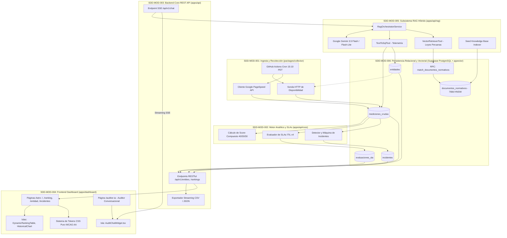

# Especificaciones Técnicas (SDD) - Observatorio de Calidad Digital Pública

* **Proyecto:** Observatorio de Calidad Digital Pública (Perú)
* **Metodología:** Spec-Driven Development (SDD) & Test-Driven Development (TDD)
* **Stack Oficial:** Bun + Astro + PostgreSQL (Supabase) + pgvector + Google Gemini (Flash-Lite / Flash) + CSS Puro + GitHub Actions + Docker
* **Ruta de Especificaciones:** `./docs/SDD/`
* **Versión del Conjunto:** 2.0.0
* **Estado:** Aprobado para Codificación Asistida por IA y Desarrollo Humano

---

## 1. Visión General y Mapa de Módulos (SDD)

El conjunto de especificaciones técnicas formaliza la arquitectura del Observatorio en **6 módulos desacoplados y autocontenidos**, eliminando ambigüedades técnicas y sirviendo como **Fuente Única de Verdad (Single Source of Truth)** para agentes autónomos (Claude Code, Antigravity, Cursor) y desarrolladores de software.

El sistema desacopla la recolección autónoma en segundo plano (GitHub Actions cron diario a las 15:10 PET) de la capa de visualización e interacción. **El Frontend y Backend no ejecutan raspado web síncrono al atender usuarios; se conectan directamente a la base de datos PostgreSQL en Supabase**, sirviendo métricas consolidadas en menos de 500 ms y alimentando el subsistema RAG híbrido.

---

## 2. Índice de Especificaciones Técnicas

| Documento | Módulo / Componente | Requerimientos Clave | Descripción y Enfoque Arquitectónico |
| :--- | :--- | :--- | :--- |
| [**01-collector-ingesta.spec.md**](./01-collector-ingesta.spec.md) | **Módulo de Recolección y Telemetría Cruda** (`packages/collector`) | RF-001, RF-002, RF-003, RF-004, RF-005, RNF-001, RNF-003, RNF-005, RNF-011 | Sonda HTTP de uptime/latencia, auditoría Google PageSpeed API (Core Web Vitals & WCAG 2.1), rate-limiting y persistencia inmutable en PostgreSQL. |
| [**02-analytics-slas-incidentes.spec.md**](./02-analytics-slas-incidentes.spec.md) | **Motor Analítico de Calidad, SLAs e Incidentes** (`apps/api/core`) | RF-006, RF-007, RF-008, RF-009, RF-012, RNF-001, RNF-003, RNF-007, RNF-010 | Algoritmo de ponderación (40% Disponibilidad, 30% Rendimiento, 30% Accesibilidad), normalización de métricas, máquina de estados de incidentes ITIL v4 y evaluación de acuerdos de nivel de servicio. |
| [**03-backend-api-reportes.spec.md**](./03-backend-api-reportes.spec.md) | **Backend Core REST API y Chatbot RAG** (`apps/api`) | RF-010, RF-011, RF-013, RF-014, RNF-001, RNF-004, RNF-005, RNF-009, RNF-011, RNF-012 | Conexión directa a Supabase PostgreSQL (≤ 500 ms), contratos de fichas técnicas, rankings, filtrado, exportación streaming CSV/JSON y endpoint conversacional `POST /api/v1/chat` con Server-Sent Events (SSE). |
| [**04-frontend-dashboard.spec.md**](./04-frontend-dashboard.spec.md) | **Frontend Dashboard y Sistema de Diseño Accesible** (`apps/dashboard`) | RF-010, RF-011, RF-014, RNF-002, RNF-006, RNF-007, RNF-010, RNF-011, RNF-012 | Interfaz pública en Astro, arquitectura de islas (Zero JS por defecto), sistema de tokens en CSS Puro WCAG 2.1 AA, página `/auditor-ia` e isla interactiva `AuditChatWidget.tsx` con streaming de respuestas. |
| [**05-rag-auditoria-inteligente.spec.md**](./05-rag-auditoria-inteligente.spec.md) | **Subsistema RAG Híbrido y Diagnóstico Prescriptivo** (`apps/api/rag`) | RF-010, RF-014, RNF-001, RNF-007, RNF-009, RNF-010, RNF-011, RNF-012 | Agente RAG con Google Gemini (Flash / Flash-Lite), orquestación híbrida con Text-to-SQL (`TextToSqlTool`) y búsqueda semántica en leyes peruanas (`VectorRetrieverTool`), chunker indexador y guardrails anti-alucinación. |
| [**06-database-persistencia-vectorial.spec.md**](./06-database-persistencia-vectorial.spec.md) | **Persistencia Relacional y Vectorial en Supabase** (`supabase/database`) | RF-001, RF-002, RF-003, RF-004, RF-005, RF-009, RF-012, RF-014, RNF-001, RNF-003, RNF-004, RNF-005, RNF-011, RNF-012 | Esquema unificado DDL de 5 tablas (`entidades`, `mediciones_crudas`, `incidentes`, `evaluaciones_sla`, `documentos_normativos`), extensión `pgvector` 768d con índice HNSW, RPC de similitud, RLS y presupuesto <55 MB (<12% de 500 MB). |

---

## 3. Matriz de Trazabilidad Completa (Requerimientos vs. SDDs)

| ID Requerimiento | Tipo | Descripción Resumida | SDD Responsable | ADR Relacionado |
| :--- | :---: | :--- | :---: | :---: |
| **RF-001** | Funcional | Extracción y gestión de catálogo de 90 URLs | `01-collector-ingesta.spec.md`, `06-database-persistencia-vectorial.spec.md` | ADR-0003 |
| **RF-002** | Funcional | Sonda de disponibilidad (Uptime) y latencia HTTP | `01-collector-ingesta.spec.md`, `06-database-persistencia-vectorial.spec.md` | ADR-0001, ADR-0003 |
| **RF-003** | Funcional | Auditoría de velocidad y Core Web Vitals | `01-collector-ingesta.spec.md`, `06-database-persistencia-vectorial.spec.md` | ADR-0006 |
| **RF-004** | Funcional | Auditoría de accesibilidad según WCAG 2.1 AA | `01-collector-ingesta.spec.md`, `06-database-persistencia-vectorial.spec.md` | ADR-0006 |
| **RF-005** | Funcional | Clasificación por categoría y región geográfica | `01-collector-ingesta.spec.md`, `06-database-persistencia-vectorial.spec.md` | ADR-0003 |
| **RF-006** | Funcional | Cálculo de puntaje global de cumplimiento (0-100) | `02-analytics-slas-incidentes.spec.md` | ADR-0003 |
| **RF-007** | Funcional | Normalización determinista de métricas técnicas | `02-analytics-slas-incidentes.spec.md` | ADR-0001 |
| **RF-008** | Funcional | Detección estadística de anomalías y degradación | `02-analytics-slas-incidentes.spec.md` | ADR-0001 |
| **RF-009** | Funcional | Agregación de metadatos, series temporales y notas | `02-analytics-slas-incidentes.spec.md`, `06-database-persistencia-vectorial.spec.md` | ADR-0003 |
| **RF-010** | Funcional | Dashboard interactivo con rankings y filtros | `04-frontend-dashboard.spec.md`, `03-backend-api-reportes.spec.md` | ADR-0002, ADR-0004 |
| **RF-011** | Funcional | Ficha técnica e historial individual por portal | `04-frontend-dashboard.spec.md`, `03-backend-api-reportes.spec.md` | ADR-0002, ADR-0004 |
| **RF-012** | Funcional | Gestión de incidentes y SLAs según marco ITIL v4 | `02-analytics-slas-incidentes.spec.md`, `06-database-persistencia-vectorial.spec.md` | ADR-0003 |
| **RF-013** | Funcional | Generación y exportación de reportes CSV / JSON | `03-backend-api-reportes.spec.md` | ADR-0001 |
| **RF-014** | Funcional | Asistente conversacional de auditoría y remediación (RAG) | `05-rag-auditoria-inteligente.spec.md`, `03-backend-api-reportes.spec.md`, `04-frontend-dashboard.spec.md`, `06-database-persistencia-vectorial.spec.md` | ADR-0008, ADR-0009 |
| **RNF-001** | No Funcional | Tiempo de respuesta del backend $\le 500\text{ ms}$ | `03-backend-api-reportes.spec.md`, `06-database-persistencia-vectorial.spec.md` | ADR-0001 |
| **RNF-002** | No Funcional | Carga inicial del dashboard frontend $\le 3\text{ s}$ | `04-frontend-dashboard.spec.md` | ADR-0002 |
| **RNF-003** | No Funcional | Capacidad para 90 entidades con 1 año de historial | `01-collector-ingesta.spec.md`, `06-database-persistencia-vectorial.spec.md` | ADR-0003 |
| **RNF-004** | No Funcional | Autenticación y permisos de endpoints protegidos / RLS | `03-backend-api-reportes.spec.md`, `06-database-persistencia-vectorial.spec.md` | ADR-0001 |
| **RNF-005** | No Funcional | Cifrado y resguardo de credenciales sensibles | `01-collector-ingesta.spec.md`, `06-database-persistencia-vectorial.spec.md` | ADR-0005 |
| **RNF-006** | No Funcional | Accesibilidad estricta WCAG 2.1 AA (contraste $\ge 4.5:1$) | `04-frontend-dashboard.spec.md` | ADR-0004 |
| **RNF-007** | No Funcional | Modularidad y cobertura de pruebas unitarias $\ge 80\%$ | Todos los módulos | ADR-0001, ADR-0007 |
| **RNF-008** | No Funcional | Tolerancia a fallos de red y reintentos exponenciales | `01-collector-ingesta.spec.md`, `05-rag-auditoria-inteligente.spec.md` | ADR-0005, ADR-0006 |
| **RNF-009** | No Funcional | Interoperabilidad con APIs externas y exportación abierta | `01-collector-ingesta.spec.md`, `03-backend-api-reportes.spec.md` | ADR-0006 |
| **RNF-010** | No Funcional | Cumplimiento de Ley D.L. 1412 y normas de accesibilidad | `02-analytics-slas-incidentes.spec.md`, `05-rag-auditoria-inteligente.spec.md` | ADR-0004 |
| **RNF-011** | No Funcional | Costos operativos $\$0\text{ USD/mes}$ (Serverless/Free Tier) | `01-collector-ingesta.spec.md`, `05-rag-auditoria-inteligente.spec.md`, `06-database-persistencia-vectorial.spec.md` | ADR-0005, ADR-0008, ADR-0009 |
| **RNF-012** | No Funcional | Fidelidad factual y anclaje normativo del RAG (sin alucinaciones) | `05-rag-auditoria-inteligente.spec.md`, `06-database-persistencia-vectorial.spec.md` | ADR-0009 |

---

## 4. Guía de Implementación para Agentes de IA y Desarrolladores

1. **Orden de Implementación Secuencial:**
   - **Paso 1: Persistencia Relacional y Vectorial (`supabase/database`)**
     - Ejecutar scripts DDL en Supabase PostgreSQL habilitando `vector(768)` y creando las 5 tablas principales, índices HNSW y B-Trees, y la función RPC `match_documentos_normativos()` siguiendo [**06-database-persistencia-vectorial.spec.md**](./06-database-persistencia-vectorial.spec.md).
   - **Paso 2: Ingesta y Recolección Autónomo (`packages/collector`)**
     - Mantener el script de recolección desacoplado ejecutándose en GitHub Actions a las 15:10 PET (`daily-audit.yml`), almacenando telemetría en `mediciones_crudas` siguiendo [**01-collector-ingesta.spec.md**](./01-collector-ingesta.spec.md).
   - **Paso 3: Motor de Dominio Analítico (`apps/api/core`)**
     - Implementar servicios de normalización de métricas, máquina de estados de incidentes ITIL v4 y evaluador de SLAs siguiendo [**02-analytics-slas-incidentes.spec.md**](./02-analytics-slas-incidentes.spec.md).
   - **Paso 4: Indexación de Base de Conocimiento y Motor RAG (`apps/api/rag`)**
     - Implementar el script `seed-normative-db.ts` para chunkear e indexar `docs/knowledge_base/` con `gemini-embedding-001`.
     - Implementar `RagOrchestratorService`, `TextToSqlTool` y `VectorRetrieverTool` con guardrails anti-alucinación siguiendo [**05-rag-auditoria-inteligente.spec.md**](./05-rag-auditoria-inteligente.spec.md).
   - **Paso 5: Backend Core REST API (`apps/api`)**
     - Conectar `apps/api` directamente a Supabase PostgreSQL para consultar entidades, rankings y series temporales (sin scraping en vivo).
     - Exponer endpoint `POST /api/v1/chat` con streaming SSE siguiendo [**03-backend-api-reportes.spec.md**](./03-backend-api-reportes.spec.md).
   - **Paso 6: Frontend Dashboard Accesible (`apps/dashboard`)**
     - Desarrollar vistas públicas estáticas/SSR en Astro conectadas al backend.
     - Crear la vista `/auditor-ia` e hidratar el widget interactivo `AuditChatWidget.tsx` para streaming de respuestas asistidas por IA siguiendo [**04-frontend-dashboard.spec.md**](./04-frontend-dashboard.spec.md).

2. **Convenciones de Código y Arquitectura:**
   - Todo el código debe estar escrito en **TypeScript** en modo estricto (`"strict": true`).
   - Cero dependencias CSS de terceros: únicamente `tokens.css` nativo con contraste WCAG 2.1 AA ($\ge 4.5:1$).
   - Runtime de alta velocidad **Bun** para desarrollo y ejecución (`Bun.serve`, APIs de red nativas).
   - Modelo de IA de Google Gemini bajo estrategia de dos niveles (Flash-Lite para pruebas/evaluación y Flash para interactividad en producción) vía `@google/genai`.
