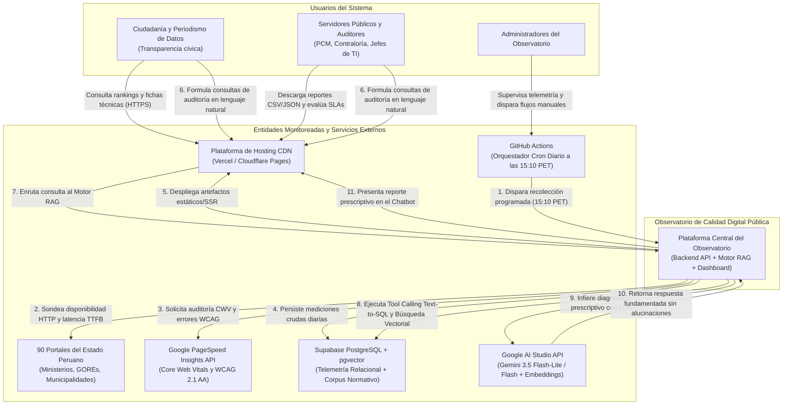
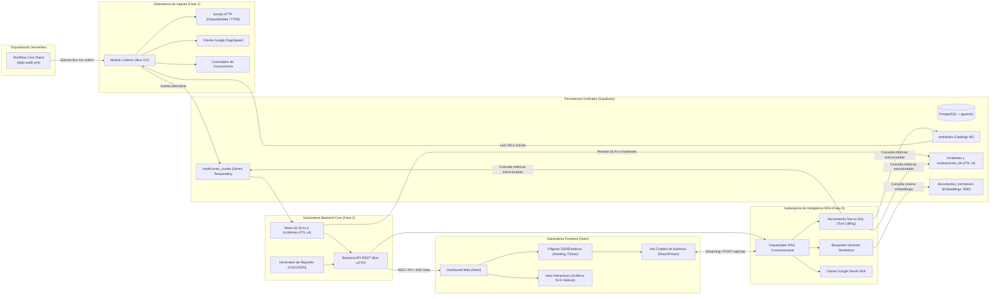
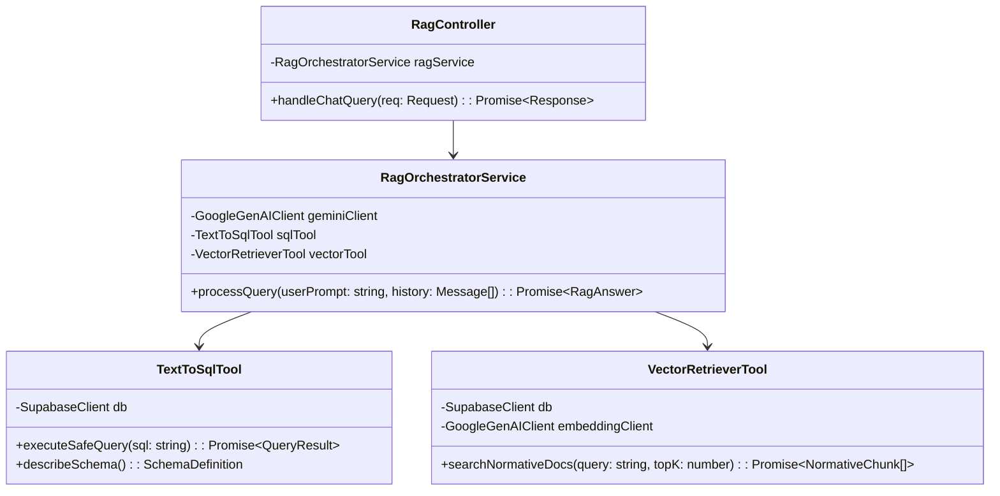

# Arquitectura del Sistema - Observatorio de Calidad Digital Pública

* **Documento:** Especificación Arquitectónica en 3 Niveles (Actualizado con Sistema Inteligente RAG)
* **Fecha:** 2026-10-16
* **Estado:** Aprobado
* **Relación con ADRs:** ADR-0001 (Bun), ADR-0002 (Astro), ADR-0003 (PostgreSQL/Supabase), ADR-0004 (CSS Puro), ADR-0005 (GitHub Actions), ADR-0006 (Google APIs PageSpeed), ADR-0007 (Docker), ADR-0008 (pgvector en Supabase), ADR-0009 (Google Gemini 3.5 Flash-Lite / Flash para RAG).

---

## 1. Visión General y Principio de Desacoplamiento

La arquitectura del sistema está diseñada para resolver dos necesidades fundamentales en un ciclo de vida evolutivo y modular:
1. **Recolección objetiva y continua:** Capturar telemetría cruda diaria de 90 portales del Estado peruano de forma automatizada y desatendida a costo cero.
2. **Auditoría prescriptiva e inteligencia de servicio:** Superar la limitación de los dashboards tradicionales mediante un **motor RAG híbrido** que traduce métricas numéricas y violaciones WCAG en diagnósticos técnicos y dictámenes normativos fundamentados en la Ley de Gobierno Digital (D.L. 1412 y D.S. 029-2021-PCM).

```
┌────────────────────────────────────────────────────────────────────────────────────────┐
│                                 EVOLUCIÓN EN 3 FASES                                   │
│                                                                                        │
│   FASE 1 (Operación Diaria Automatizada):                                              │
│   [GitHub Actions (Cron)] ──▶ [Módulo Captura Cruda] ──▶ [Supabase PostgreSQL]         │
│                                                                                        │
│   FASE 2 (Backend Core + Dashboard Astro):                                             │
│   [Módulo Captura] ──(Se integra en)──▶ [Backend Core API (Bun)]                       │
│                                                   │                                    │
│                                                   ▼                                    │
│                                         [Dashboard Web (Astro)]                        │
│                                                                                        │
│   FASE 3 (Capa de Inteligencia RAG Híbrida):                                           │
│   [Supabase: SQL + pgvector] ◀──▶ [Motor RAG (Gemini 3.5)] ──▶ [Auditor Conversacional]│
└────────────────────────────────────────────────────────────────────────────────────────┘
```

---

## 2. Nivel 1: Arquitectura de Contexto e Interacción Global

Representa cómo interactúan los diferentes perfiles de usuarios, el sistema central del Observatorio y todos los servicios externos (sensores, APIs de auditoría, base de datos relacional y vectorial, e infraestructura de IA generativa).

### Diagrama de Contexto (Mermaid)



### Descripción de Flujos de Nivel 1
1. **Orquestación Desatendida:** GitHub Actions dispara diariamente a las 15:10 PET el colector de telemetría sin intervención humana.
2. **Sondeo Directo:** Sondas HTTP verifican disponibilidad (códigos 200, 403, 500, timeouts y DNS) sobre los 90 portales.
3. **Auditoría Imparcial:** Consulta a Google PageSpeed API para obtener Core Web Vitals (LCP, CLS, FCP) y auditoría de accesibilidad WCAG 2.1.
4. **Persistencia Híbrida:** Supabase almacena la serie temporal relacional y aloja el corpus normativo peruano indexado en vectores mediante `pgvector`.
5. **Consulta Pública del Dashboard:** Usuarios acceden al dashboard en Astro servido en CDN con velocidad ultrarrápida (LCP < 1.5s).
6. **Auditoría Inteligente Asistida por RAG:** Funcionarios y ciudadanos interactúan en lenguaje natural con el asistente. El sistema consulta a Gemini para generar SQL dinámico sobre la telemetría, recupera artículos de leyes peruanas mediante similitud de vectores, y sintetiza diagnósticos prescriptivos accionables.

---

## 3. Nivel 2: Arquitectura de Contenedores y Módulos

Desglosa los subsistemas que componen el Observatorio, delimitando sus responsabilidades, protocolos de comunicación y almacenamiento.

### Diagrama de Módulos (Mermaid)



### Responsabilidades de los Módulos de Nivel 2
* **Módulo de Captura Cruda (`packages/collector`):** CLI autónomo ejecutado por GitHub Actions. Aplica sondas HTTP con control de timeouts (10s) y consume PageSpeed API con backoff exponencial, insertando en lotes pequeños en Supabase.
* **Supabase PostgreSQL + `pgvector`:** Almacén único de la verdad. Mantiene el catálogo relacional, las series de tiempo de telemetría y la tabla de embeddings vectoriales a 768 dimensiones sin superar el 12 % de la cuota gratuita (ADR-0008).
* **Backend Core API (`apps/api`):** Evalúa la continuidad de fallas para abrir/cerrar incidentes según ITIL v4, calcula porcentajes de SLA mensual y expone endpoints REST estructurados.
* **Subsistema RAG (`apps/api/src/modules/rag`):**
  * Orquesta la interacción con **Google Gemini (3.5 Flash-Lite para evaluación y 3.5 Flash para producción)** mediante el SDK oficial `@google/genai` (ADR-0009).
  * Cuenta con dos herramientas acopladas: `TextToSqlTool` (consulta de telemetría) y `VectorRetrieverTool` (búsqueda semántica sobre leyes D.L. 1412, D.S. 029-2021-PCM y WCAG 2.1).
* **Frontend Astro (`apps/dashboard`):** Ofrece visualización accesible Zero-JS por defecto para rankings y fichas, incorporando la isla interactiva `AuditChatWidget` para el diálogo con el asistente RAG.

---

## 4. Nivel 3: Arquitectura de Código y Componentes

Define la estructura de directorios, capas y contratos de código para todos los componentes del monorepo.

```
GSTI_project/
├── .github/
│   └── workflows/
│       └── daily-audit.yml              # Orquestador cron diario (15:10 PET)
├── packages/
│   └── collector/                       # MÓDULO DE CAPTURA CRUDA (Fase 1 - Operativo)
├── apps/
│   ├── api/                             # BACKEND CORE + MOTOR RAG (Fases 2 y 3)
│   └── dashboard/                       # FRONTEND ASTRO + CHATBOT (Fases 2 y 3)
└── docs/
    ├── ADRs/                            # Registro formal de decisiones (ADR-0001 a 0009)
    ├── architecture/                    # Especificaciones arquitectónicas
    └── schemes/                         # Diagramas y modelos de datos
```

---

### 4.1. Módulo de Captura Cruda (`packages/collector`) — *Arquitectura Hexagonal*

Mantiene estricto desacoplamiento entre el dominio de auditoría y los adaptadores de infraestructura:

```
packages/collector/
├── package.json                         # Runtime Bun
├── tsconfig.json
├── src/
│   ├── index.ts                         # Exportación pública del módulo
│   ├── cli.ts                           # Entrypoint para GitHub Actions
│   │
│   ├── core/                            # Dominio y Abstracciones
│   │   ├── models/
│   │   │   ├── entity.model.ts          # Interface de Entidad Pública
│   │   │   ├── probe-result.model.ts    # Modelo de telemetría HTTP
│   │   │   └── audit-result.model.ts    # Modelo de Core Web Vitals y WCAG
│   │   └── ports/
│   │       ├── entity-repository.port.ts
│   │       ├── measurement-repository.port.ts
│   │       ├── http-probe.port.ts
│   │       └── audit-service.port.ts
│   │
│   ├── infrastructure/                  # Adaptadores Tecnológicos
│   │   ├── http/fetch-http-probe.ts     # Sonda nativa Bun (timeout 10s)
│   │   ├── google/pagespeed-client.ts   # Cliente PageSpeed API v5
│   │   ├── persistence/supabase-measurement-repo.ts # Persistencia en lotes de 10
│   │   └── config/env.config.ts         # Validación de variables de entorno
│   │
│   └── application/                     # Orquestación de Casos de Uso
│       ├── run-full-audit.usecase.ts    # Auditoría por lotes de 90 entidades
│       └── rate-limiter.ts              # Control de concurrencia
```

---

### 4.2. Backend Core y Módulo RAG (`apps/api`) — *Fases 2 y 3*

Combina los servicios REST de analítica con el orquestador inteligente RAG:

```
apps/api/
├── package.json                         # Runtime Bun + @google/genai + @supabase/supabase-js
├── tsconfig.json
├── src/
│   ├── server.ts                        # Servidor HTTP Bun
│   ├── config/
│   │   ├── database.ts                  # Conexión a PostgreSQL / Supabase
│   │   ├── gemini.ts                    # Cliente Google GenAI (Flash-Lite / Flash)
│   │   └── env.ts                       # Validación (GEMINI_API_KEY, SUPABASE_KEY)
│   │
│   ├── modules/
│   │   ├── entities/                    # Catálogo de entidades públicas
│   │   │   ├── entities.controller.ts
│   │   │   └── entities.service.ts
│   │   ├── metrics/                     # Series temporales crudas
│   │   │   ├── metrics.controller.ts
│   │   │   └── metrics.service.ts
│   │   ├── slas/                        # Análisis de SLAs según ITIL v4
│   │   │   ├── sla-calculator.service.ts
│   │   │   └── sla.controller.ts
│   │   ├── incidents/                   # Ciclo de vida de incidentes
│   │   │   ├── incident-detector.service.ts
│   │   │   └── incidents.controller.ts
│   │   ├── reports/                     # Exportación CSV y JSON
│   │   │   └── reports.controller.ts
│   │   │
│   │   └── rag/                         # SUBSISTEMA RAG INTELIGENTE (Fase 3)
│   │       ├── rag.controller.ts        # Endpoint POST /api/chat (Streaming y JSON)
│   │       ├── rag-orchestrator.service.ts # Orquestador Gemini con Tool Calling
│   │       ├── prompts/
│   │       │   ├── system-auditor.prompt.ts # Instrucciones de rol, guardrails y contexto
│   │       │   └── sql-generation.prompt.ts # Reglas para Text-to-SQL seguro
│   │       ├── tools/
│   │       │   ├── text-to-sql.tool.ts  # Herramienta de consulta SQL sobre telemetría
│   │       │   └── vector-retriever.tool.ts # Búsqueda en pgvector (similitud coseno)
│   │       └── indexer/
│   │           ├── chunker.ts           # División de leyes y pautas WCAG en fragmentos
│   │           └── seed-normative-db.ts # Script de carga con gemini-embedding-001
│   │
│   └── middlewares/
│       ├── rate-limit-middleware.ts     # Control de cuota (15 RPM)
│       └── error-handler.ts
```

#### Diagrama de Clases del Subsistema RAG (Mermaid)



---

### 4.3. Frontend Dashboard y Chatbot (`apps/dashboard`) — *Fase 2 y 3*

Construido en **Astro** para mantener un LCP < 1.5s y cero dependencias CSS externas:

```
apps/dashboard/
├── astro.config.mjs
├── package.json
├── src/
│   ├── layouts/
│   │   └── DashboardLayout.astro        # Layout institucional accesible
│   │
│   ├── pages/
│   │   ├── index.astro                  # Resumen ejecutivo nacional (Top 10 / KPIs)
│   │   ├── ranking.astro                # Tabla completa de 90 entidades con filtros
│   │   ├── entidad/[id].astro           # Ficha técnica individual y serie temporal
│   │   ├── incidentes.astro             # Gestión de incidentes y SLAs (ITIL v4)
│   │   ├── reportes.astro               # Centro de descargas de datos abiertos
│   │   └── auditor-ia.astro             # Vista dedicada del Asistente RAG
│   │
│   ├── components/ui/                   # Componentes estáticos Astro
│   │   ├── KpiCard.astro
│   │   └── BadgeStatus.astro
│   │
│   ├── islands/                         # Componentes hidratados interactivos
│   │   ├── DynamicRankingTable.tsx      # Tabla interactiva con ordenamiento
│   │   ├── HistoricalMetricsChart.tsx   # Gráficos Chart.js de Uptime y CWV
│   │   └── AuditChatWidget.tsx          # Widget conversacional de auditoría RAG
│   │
│   └── styles/                          # CSS Puro nativo (ADR-0004)
│       ├── tokens.css                   # Paleta WCAG AA y variables de diseño
│       └── layout.css
```

---

## 5. Matriz de Trazabilidad Arquitectónica

| Requerimiento | Nivel 1 (Contexto) | Nivel 2 (Módulos) | Nivel 3 (Componentes de Código) | ADR Asociada |
| :--- | :--- | :--- | :--- | :--- |
| **RF-001 (Catálogo 90 URLs)** | Conexión con portales | Catálogo `entidades` | `entity.model.ts`, `IEntityRepository` | ADR-0003 |
| **RF-002 (Disponibilidad HTTP)** | Sonda HTTP | Sonda de disponibilidad | `FetchHttpProbe`, `probe-result.model.ts` | ADR-0001 |
| **RF-003 (Core Web Vitals)** | Google PageSpeed API | Cliente PageSpeed | `PageSpeedClient`, `audit-result.model.ts` | ADR-0006 |
| **RF-004 (WCAG 2.1 AA)** | Google PageSpeed API | Extractor de violaciones | `PageSpeedClient` (`errores_accesibilidad`) | ADR-0006 |
| **RF-006 (Ejecución Diaria)** | GitHub Actions Cron | Workflow desatendido | `.github/workflows/daily-audit.yml` | ADR-0005 |
| **RF-008 (Incidentes / SLAs)** | Gestión de Eventos | Motor de SLAs (ITIL v4) | `apps/api/src/modules/slas/`, `incidents/` | ADR-0003 |
| **RF-009 (Dashboard Astro)** | Hosting CDN | Framework Astro | `apps/dashboard/src/pages/index.astro` | ADR-0002, ADR-0004 |
| **RF-010 (Auditoría RAG IA)** | Google AI Studio | Subsistema RAG + pgvector | `apps/api/src/modules/rag/`, `AuditChatWidget.tsx` | ADR-0008, ADR-0009 |
| **RNF-001 (Latencia Backend)** | Conexión directa Bun | Runtime Bun nativo | `Bun.serve` con tiempos < 50 ms | ADR-0001 |
| **RNF-002 (Carga Web ≤ 3s)** | Despliegue estático | Astro Islands Architecture | Zero JS por defecto en componentes `.astro` | ADR-0002 |
| **RNF-006 (Accesibilidad AA)** | Interacción ciudadana | Sistema de tokens CSS | `tokens.css` (contraste $\ge 4.5:1$) | ADR-0004 |
| **RNF-011 (Costo Cero $0/mes)**| GitHub + Supabase + Gemini | Capas gratuitas unificadas | Cuotas gratuitas analizadas y verificadas | ADR-0005, 0008, 0009 |

---

*Especificación técnica de arquitectura v2.0 — Observatorio de Calidad Digital Pública del Perú.*
