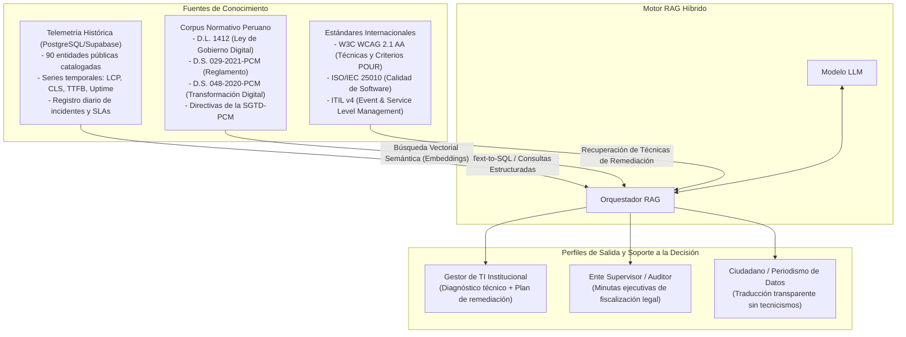
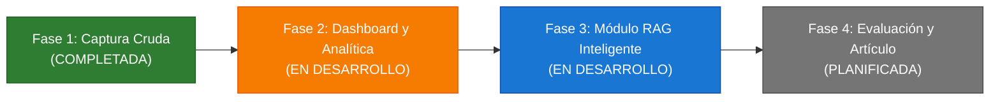

# Observatorio de Calidad Digital Pública del Perú
## Documento Maestro de Contexto, Objetivos, Arquitectura Técnica y Sistema Inteligente RAG

> **Tipo de proyecto:** Sistema inteligente de observabilidad continua y auditoría prescriptiva para servicios digitales del Estado Peruano.  
> **Naturaleza:** Investigación aplicada en Ingeniería de Software y Gestión de TI (Design Science Research) + Desarrollo de software (arquitectura hexagonal, monorepo).  
> **Alcance empírico:** Catálogo maestro de 90 entidades públicas (19 Ministerios, 25 Gobiernos Regionales, 31 Municipalidades Provinciales estratégicas y 15 Organismos Autónomos).  
> **Estado:** Fase 1 en producción (captura diaria automatizada); Fase 2 (dashboard y analítica) y Fase 3 (módulo RAG) en desarrollo.

---

# PARTE 1: ENFOQUE ESTRATÉGICO, OBJETIVOS Y SISTEMA INTELIGENTE RAG

## 1. Planteamiento del Problema y Justificación

### 1.1 La realidad de los servicios web del Estado Peruano
Los portales web constituyen el canal prioritario de interacción entre la ciudadanía y el Estado para la consulta de información, realización de trámites y acceso a mesas de partes virtuales. No obstante, las mediciones empíricas preliminares ejecutadas sobre 90 entidades del Estado evidencian **deficiencias persistentes y reproducibles** que afectan la disponibilidad, el rendimiento y la accesibilidad:

- **Fallas críticas de resolución de nombres (`ENOTFOUND`):** Dominios institucionales que no resuelven DNS (p. ej. portales de los Gobiernos Regionales de Tacna, Ayacucho y Arequipa).
- **Vulnerabilidades de seguridad en transporte (TLS/SSL):** Certificados digitales expirados (p. ej. GORE Piura), que exponen al ciudadano a alertas de navegación y riesgos de interceptación.
- **Bloqueos de acceso no controlados:** Respuestas HTTP 403 ante solicitudes legítimas (p. ej. GORE Callao).
- **Latencias críticas de conexión (>10 s):** Timeouts reiterados en entidades de alto impacto (GORE Loreto, Ica, Ucayali, Amazonas, Lambayeque; SUNAFIL).
- **Rendimiento deficiente en carga:** Portales con puntajes Lighthouse entre 12 y 16 sobre 100 y tiempos de renderizado de contenido principal (LCP) superiores a 13 segundos (p. ej. Huancavelica).
- **Barreras severas de accesibilidad:** Puntuaciones promedio de 56/100 frente a las directivas de accesibilidad obligatorias (WCAG 2.1 AA), excluyendo sistemáticamente a personas con discapacidad visual y motriz.

### 1.2 La brecha de decisión e interpretación: Por qué un dashboard no es suficiente
Tradicionalmente, las iniciativas de evaluación digital se han limitado a mediciones puntuales o a tableros de control (*dashboards*) estáticos. Este enfoque presenta limitaciones estructurales:

1. **Carencia de evidencia longitudinal:** Las evaluaciones aisladas no permiten distinguir entre incidentes transitorios y obsolescencia crónica de la infraestructura tecnológica, imposibilitando la rendición de cuentas (*accountability*).
2. **La brecha de interpretación técnica:** Un dashboard convencional expone métricas cuantitativas crudas (LCP en segundos, TTFB en milisegundos, violaciones WCAG por código). Ni el ciudadano común, ni los periodistas, ni los funcionarios de TI de gobiernos locales y regionales poseen herramientas directas para traducir esas cifras a planes de remediación técnica o determinar con precisión qué artículo de la normativa nacional se está vulnerando.
3. **Falta de soporte prescriptivo a la gobernanza:** Existe un vacío entre la recolección masiva de telemetría y la toma de decisiones informada. Las entidades públicas requieren no solo saber que su servicio está degradado, sino recibir recomendaciones técnicas accionables fundamentadas en estándares internacionales y en el marco legal del gobierno digital peruano.

Para cerrar esta brecha, el proyecto integra una **capa de telemetría longitudinal automatizada bajo principios de ITIL v4 e ISO/IEC 25010** con un **agente conversacional inteligente basado en Retrieval-Augmented Generation (RAG)**, transformando los datos crudos en auditorías e instrucciones de remediación comprensibles y accionables.

---

## 2. Propuesta de Valor del Proyecto

El valor que aporta el proyecto se estructura en tres dimensiones complementarias:

```
                                  VALOR DEL PROYECTO
                                           │
         ┌─────────────────────────────────┼─────────────────────────────────┐
         ▼                                 ▼                                 ▼
┌──────────────────┐             ┌──────────────────┐             ┌──────────────────┐
│ Aporte Técnico / │             │  Aporte GSTI y   │             │ Aporte Social y  │
│   Metodológico   │             │    Gobernanza    │             │ Política Pública │
└────────┬─────────┘             └────────┬─────────┘             └────────┬─────────┘
         │                                │                                │
 ├─ Panel longitudinal diario     ├─ ITIL v4 aplicado a la         ├─ Cumplimiento D.L. 1412 /
 │  (no fotos transversales)         calidad externa del servicio     D.S. 029-2021-PCM
 ├─ Telemetría reproducible       ├─ SLAs de cara al ciudadano     ├─ Inclusión digital medible
 │  (90 entidades a costo cero)   ├─ Gestión formal de eventos        (WCAG 2.1 AA personas
 └─ Auditoría automatizada           e incidentes de TI               con discapacidad)
```

### 2.1 Aporte Técnico y Metodológico
- **Panel Longitudinal Continuo:** Frente al 90 % de estudios primarios de la literatura científica que reportan únicamente una medición puntual, este trabajo aporta la primera serie de tiempo diaria y automatizada de 90 portales del Estado Peruano.
- **Estandarización y Reproducibilidad a Costo Cero:** Empleo de instrumentos abiertos (PageSpeed Insights API v5, sondas HTTP) y arquitectura serverless gratuita (GitHub Actions + Supabase), permitiendo su replicación y auditoría científica sin requerir presupuesto de infraestructura (RNF-011).

### 2.2 Aporte en Gestión de Sistemas y Tecnologías de Información (GSTI)
- **Extensión Externa de ITIL v4:** Se trasladan las prácticas de **Gestión de Eventos, Gestión de Incidentes y Gestión de Niveles de Servicio (SLA)** fuera de la infraestructura interna de TI, evaluando la calidad del servicio directamente en el punto de contacto con el ciudadano.
- **Operacionalización de Calidad de Software (ISO/IEC 25010):** Se traducen conceptos abstractos de confiabilidad, eficiencia de desempeño y accesibilidad en indicadores cuantitativos objetivos de nivel de servicio.

### 2.3 Aporte Social y de Política Pública
- **Fiscalización del Cumplimiento Normativo:** Verifica el acatamiento efectivo del **Decreto Legislativo N.º 1412 (Ley de Gobierno Digital)** y del **D.S. N.º 029-2021-PCM**, evidenciando las deficiencias que la normativa prohíbe pero que no eran supervisadas continuamente.
- **Inclusión y Derechos Digitales:** Cuantifica la accesibilidad real (WCAG 2.1) como garantía de no discriminación y acceso equitativo a los servicios públicos para personas con discapacidad.

---

## 3. Arquitectura y Rol del Asistente Inteligente RAG

### 3.1 Naturaleza del RAG: Agente de Auditoría y Diagnóstico Prescriptivo
El componente conversacional no opera como un chatbot genérico de preguntas y respuestas frecuentes (FAQ), sino como un **motor RAG híbrido (estructurado y no estructurado)** especializado en auditoría y soporte a la decisión:



### 3.2 Casos de Uso y Perfiles de Interacción

#### Caso A: El Gestor de TI Institucional (Diagnóstico y Remediación)
- **Consulta:** *"¿Por qué la Municipalidad Provincial de Trujillo tiene su SLA en estado 'En Riesgo' este mes y qué debemos corregir para alinearnos a la normativa de gobierno digital?"*
- **Comportamiento RAG:**
  1. Extrae los registros históricos de telemetría de la entidad: identifica 5 caídas vespertinas (TTFB > 10 s) y un puntaje de accesibilidad de 52/100.
  2. Identifica violaciones críticas específicas: ausencia de atributos `alt` en imágenes esenciales y contraste de color insuficiente (Criterio WCAG 1.4.3).
  3. Recupera y cita el articulado pertinente del **D.S. 029-2021-PCM** sobre la obligatoriedad del estándar WCAG 2.1 nivel AA.
  4. Formula una prescripción técnica paso a paso para el equipo de desarrollo web de la municipalidad.

#### Caso B: El Ente Supervisor o Auditor (PCM, Contraloría, Defensoría)
- **Consulta:** *"Genera un reporte consolidado de los Gobiernos Regionales del sur que hayan presentado incidentes de certificados SSL vencidos o caídas de servicio durante el último mes."*
- **Comportamiento RAG:**
  1. Ejecuta agregaciones espaciotemporales sobre la base de datos de incidentes.
  2. Detecta patrones recurrentes (p. ej. certificados expirados en GORE Piura, fallas de resolución DNS en GORE Tacna) con fecha y hora exacta (`fecha_captura`).
  3. Redacta una minuta ejecutiva formal para fiscalización y control interno.

#### Caso C: El Ciudadano y Sociedad Civil (Transparencia e Inclusión)
- **Consulta:** *"¿El portal de trámites de mi Gobierno Regional es accesible para personas con discapacidad visual?"*
- **Comportamiento RAG:**
  1. Traduce la jerga técnica de Lighthouse a un lenguaje cívico claro: explica si los lectores de pantalla pueden interpretar el contenido o si la navegación por teclado está rota.

---

## 4. Objetivos del Proyecto

### 4.1 Objetivo General
> **Diseñar, implementar y evaluar un sistema inteligente de observabilidad continua y auditoría de la calidad de los servicios web públicos basado en RAG, determinando su efectividad en la detección de incidentes de TI y en la generación de diagnósticos prescriptivos normativos mediante un caso de estudio en 90 entidades del Estado Peruano.**

### 4.2 Objetivos Específicos

1. **OE1 (Diseño Metodológico y Telemetría Longitudinal):**  
   Modelar un esquema de evaluación multidimensional estandarizado (ISO/IEC 25010, WCAG 2.1 y Core Web Vitals) y operacionalizar un pipeline automatizado, reproducible y de bajo costo para la captura longitudinal diaria de disponibilidad, rendimiento y accesibilidad de los 90 portales web institucionales.

2. **OE2 (Marco de Gestión de Servicios y SLAs — ITIL v4):**  
   Implementar un modelo de categorización de eventos, incidentes de disponibilidad y niveles de servicio (SLA) basado en las buenas prácticas de ITIL v4, cuantificando la persistencia y recurrencia de fallas en la administración pública.

3. **OE3 (Capa de Inteligencia Conversacional y Auditoría Normativa — RAG):**  
   Desarrollar un agente conversacional basado en Retrieval-Augmented Generation (RAG) que integre la base de telemetría histórica estructurada con un corpus no estructurado de normativas peruanas (D.L. 1412, D.S. 029-2021-PCM) y guías técnicas W3C, facilitando diagnósticos interpretables y planes de acción correctiva en lenguaje natural.

4. **OE4 (Evaluación y Validación del Sistema):**  
   Evaluar empíricamente la efectividad del sistema desarrollado sobre el caso de estudio de las 90 entidades del Estado Peruano, midiendo la confiabilidad del monitoreo automatizado y la calidad del asistente RAG en términos de exactitud factual, fundamentación normativa y ausencia de alucinaciones en consultas de auditoría de TI.

---

## 5. Preguntas de Investigación del Artículo Científico

* **Pregunta Principal (RQ):**  
  *¿En qué medida un sistema inteligente de observabilidad continua asistido por RAG permite caracterizar la degradación de los servicios web del Estado Peruano y generar recomendaciones de auditoría prescriptiva conformes con la normativa de gobierno digital?*

* **Preguntas Específicas:**
  * **RQ1 (Telemetría y Estado de la Calidad):** ¿Cuál es el comportamiento longitudinal de la disponibilidad, rendimiento y accesibilidad de los 90 portales evaluados y qué brechas existen entre ministerios, gobiernos regionales y municipalidades?
  * **RQ2 (Gestión de Incidentes y SLAs bajo ITIL v4):** ¿Qué proporción de entidades incumple los umbrales de nivel de servicio (SLA) y cuál es la prevalencia de fallas crónicas frente a incidentes transitorios?
  * **RQ3 (Efectividad del RAG en Auditoría y Prescripción):** ¿Con qué grado de fidelidad factual (*faithfulness*), relevancia de respuesta y precisión normativa responde el agente RAG ante escenarios complejos de auditoría de servicios TI en comparación con evaluaciones de expertos humanos?

---

## 6. Proyección del Artículo Científico

### 6.1 Títulos Sugeridos
* **Español:**  
  *Marco de Observabilidad Continua y Auditoría Inteligente Asistida por RAG para la Calidad de Servicios Web en el Gobierno Digital Peruano*
* **Inglés:**  
  *An Intelligent Continuous Observability and RAG-based Auditing Framework for Web Service Quality in the Peruvian Digital Government*

### 6.2 Estructura del Artículo (Formato IMRaD para Scopus / IEEE / ACM)
1. **Introducción:** Relevancia de los servicios digitales estatales, brecha entre marco normativo y fiscalización continua, formulación del problema y aporte científico.
2. **Trabajos Relacionados:** Estado del arte en monitoreo de portales públicos, aplicaciones de ITIL en el sector público, y uso de LLMs/RAG en auditoría de software y cumplimiento regulatorio.
3. **Metodología y Arquitectura del Sistema:** Muestra de 90 entidades, diseño de sondas y cuotas gratuitas, modelo de eventos y SLAs (ITIL v4), y diseño del motor RAG híbrido (Text-to-SQL + embeddings normativos).
4. **Resultados Empíricos del Estado Peruano:** Hallazgos del panel longitudinal (fallas DNS, SSL, tiempos de carga, violaciones WCAG) y rankings institucionales.
5. **Evaluación Experimental del Sistema RAG:** Métricas de desempeño del modelo RAG (fidelidad factual, relevancia de respuestas, reducción de alucinaciones normativas) y validación de planes de remediación.
6. **Discusión e Implicaciones para la Gestión de TI:** Gobernanza de TI en el sector público, remediación técnica guiada por IA, y amenazas a la validez.
7. **Conclusiones y Trabajo Futuro:** Resumen de contribuciones y líneas de investigación futuras.

---

# PARTE 2: CONTEXTO TÉCNICO Y METODOLÓGICO

## 7. Requerimientos del Sistema (RF y RNF)

### 7.1 Requerimientos Funcionales Clave
| RF | Descripción | Módulo |
|----|-------------|--------|
| **RF-001** | Registro y categorización del catálogo maestro de 90 entidades públicas. | Core / Catálogo |
| **RF-002** | Verificación diaria de disponibilidad (código de estado HTTP y tiempo de respuesta con sonda de 10 s). | Colector / Sonda |
| **RF-003** | Medición de velocidad de carga y Core Web Vitals (LCP, FID/INP, CLS, FCP, TTFB) vía PageSpeed Insights API v5. | Colector / Rendimiento |
| **RF-004** | Evaluación automatizada de accesibilidad según WCAG 2.1 (Lighthouse) con discriminación de violaciones. | Colector / Accesibilidad |
| **RF-005** | Clasificación jerárquica por nivel administrativo (Ministerio, GORE, Municipalidad, Organismo Autónomo). | Core / Entidades |
| **RF-006** | Actualización periódica automatizada mediante orquestación serverless (GitHub Actions cron diario). | Infraestructura |
| **RF-007** | Detección y registro formal de incidentes de disponibilidad (DNS, SSL, 403, timeouts) con timestamp auditable. | Analítica / ITIL v4 |
| **RF-008** | Cálculo de puntaje global ponderado y clasificación de estado de SLA mensual (Cumple, En Riesgo, Incumple). | Analítica / ITIL v4 |
| **RF-009** | Visualización en dashboard público interactivo: rankings, comparativas, fichas por entidad y reportes descargables (Astro). | Frontend |
| **RF-010** | **Módulo RAG de Auditoría Conversacional:** Consulta en lenguaje natural sobre telemetría histórica y prescripción de remediación normativa. | Inteligencia RAG |

### 7.2 Requerimientos No Funcionales Clave
| RNF | Criterio | Justificación |
|-----|----------|---------------|
| **RNF-001** | Tiempo de respuesta del sistema ≤ 500 ms en consultas agregadas SQL. | Consultas optimizadas con índices espaciotemporales en PostgreSQL. |
| **RNF-002** | Carga inicial del dashboard web ≤ 3.0 s. | Arquitectura Astro con islas de interactividad y CSS puro (cero frameworks CSS pesados). |
| **RNF-003** | Almacenamiento histórico auditable de mediciones continuas (> 90 entidades). | Modelo relacional indexado en Supabase. |
| **RNF-011** | **Costo operativo cero (≤ $0/mes):** Sostenibilidad integral sobre planes gratuitos. | GitHub Actions (60 min/mes vs. 2000 disponibles), PageSpeed (90 req/día vs. 10.000), Supabase (3 MB/mes vs. 500 MB). |
| **RNF-017** | Seguridad y aislamiento de credenciales. | GitHub Secrets para llaves de servicio; ninguna clave expuesta en código fuente. |
| **RNF-027** | Diseño responsivo adaptado a dispositivos móviles. | Interfaces fluidas basadas en CSS Grid y Flexbox nativos. |

---

## 8. Marco Teórico y Referencias Normativas

### 8.1 Gobierno Digital y Marco Normativo Peruano
El marco normativo nacional impone obligaciones concretas sobre la calidad de las plataformas digitales:
- **Decreto Legislativo N.º 1412 (Ley de Gobierno Digital):** Establece el régimen jurídico aplicable al uso de las tecnologías digitales en las entidades públicas, promoviendo la interoperabilidad, la seguridad y la accesibilidad.
- **Decreto Supremo N.º 029-2021-PCM (Reglamento del D.L. 1412):** Dispone que las plataformas web institucionales deben garantizar condiciones mínimas de usabilidad, disponibilidad y accesibilidad para toda la ciudadanía.
- **Política Nacional de Transformación Digital (D.S. N.º 048-2020-PCM):** Fija como pilar la entrega de servicios públicos digitales de alta calidad centrados en las personas.
- **Ley N.º 29973 (Ley General de la Persona con Discapacidad):** Garantiza el derecho de las personas con discapacidad a acceder a la información y a los servicios digitales sin barreras discriminatorias.

### 8.2 Calidad del Software: Modelo ISO/IEC 25010 (SQuaRE)
El sistema operacionaliza el modelo de calidad de producto de software **ISO/IEC 25010**:
- **Confiabilidad / Disponibilidad:** Capacidad del servicio de estar operativo y accesible en el tiempo (sondas HTTP y tiempo de respuesta).
- **Eficiencia de Desempeño:** Tiempos de respuesta y comportamiento bajo condiciones de red estandarizadas (Core Web Vitals).
- **Usabilidad y Accesibilidad:** Grado en que el software puede ser utilizado por personas con distintas capacidades (WCAG 2.1).
- **Seguridad:** Confidencialidad y autenticidad del canal de comunicación (vigencia de certificados TLS/HTTPS).

### 8.3 Rendimiento Web: Core Web Vitals y Métricas de Laboratorio
El estándar Core Web Vitals cuantifica la experiencia de carga del usuario en tres dimensiones esenciales:
- **LCP (Largest Contentful Paint):** Percepción de velocidad de carga del elemento principal visible (umbral óptimo: ≤ 2.5 s).
- **FID / INP (First Input Delay / Interaction to Next Paint):** Responsividad ante la interacción del usuario (umbral óptimo: ≤ 100 ms).
- **CLS (Cumulative Layout Shift):** Estabilidad visual para evitar desplazamientos inesperados de contenido (umbral óptimo: ≤ 0.1).
- **FCP y TTFB:** Métricas de soporte que evalúan el primer renderizado y la latencia del servidor de alojamiento.

*Fundamento de laboratorio:* PageSpeed Insights evalúa en un entorno controlado (Chrome emulado, red y CPU estandarizadas), asegurando que las comparaciones entre las 90 entidades sean justas, reproducibles e invariantes a la calidad de la conexión de un usuario individual.

### 8.4 Accesibilidad Web: WCAG 2.1 y Principios POUR
Las pautas W3C WCAG 2.1 se estructuran en los cuatro principios fundamentales:
1. **Perceptible:** La información y los componentes no pueden ser invisibles a todos los sentidos del usuario (contraste adecuado, textos alternativos `alt`).
2. **Operable:** La navegación debe ser realizable por teclado, sin trampas de foco ni límites de tiempo arbitrarios.
3. **Comprensible:** Los textos y la estructura de navegación deben ser predecibles y legibles.
4. **Robusto:** El código HTML debe ser compatible con tecnologías asistivas actuales y futuras (lectores de pantalla).

### 8.5 Gestión de Servicios de TI: ITIL v4 aplicada a la Calidad Externa
El proyecto adopta los constructos de **ITIL v4**:
- **Evento:** Cualquier cambio de estado detectable en la sonda de monitoreo (p. ej. respuesta HTTP 200, cambio en latencia).
- **Incidente:** Una interrupción no planificada o reducción de la calidad del servicio (p. ej. timeout >10 s, certificado SSL expirado, error 500 o 403).
- **Acuerdos de Nivel de Servicio (SLA):** Compromisos de disponibilidad mensual clasificados en:
  - *Cumple:* Disponibilidad mensual ≥ 99.5 %.
  - *En Riesgo:* Disponibilidad mensual entre 98.0 % y 99.49 %.
  - *Incumple:* Disponibilidad mensual < 98.0 %.

---

## 9. Metodología de Medición e Instrumentación

### 9.1 Instrumentos y Variables Evaluadas
| Variable | Instrumento | Parámetros Técnicos |
|----------|-------------|---------------------|
| **Disponibilidad HTTP** | Sonda HTTP nativa Bun | Método `HEAD`/`GET`, timeout 10 s, registro de código de estado y DNS. |
| **Tiempo de respuesta (TTFB)** | Sonda HTTP | Medición en milisegundos hasta el primer byte del servidor. |
| **Core Web Vitals (LCP, CLS, FCP)** | Google PageSpeed Insights API v5 | Modo laboratorio móvil, red emulada 4G, CPU throttled. |
| **Puntaje de Desempeño** | Lighthouse v5+ | Escala normalizada de 0 a 100. |
| **Puntaje y Violaciones WCAG 2.1** | Lighthouse Accessibility Audit | Escala normalizada 0 a 100 y lista de reglas incumplidas (A, AA). |
| **Incidentes de Disponibilidad** | Motor de reglas de inferencia | Clasificación en: `DNS_ERROR`, `SSL_EXPIRED`, `HTTP_FORBIDDEN_403`, `TIMEOUT_GT_10S`. |

### 9.2 Población y Diseño Muestral
El universo de análisis consta de un catálogo maestro de **90 entidades públicas peruanas**, equilibrado por tipología institucional:
- **19 Ministerios:** Todo el Poder Ejecutivo y Presidencia del Consejo de Ministros.
- **25 Gobiernos Regionales (GOREs):** Cobertura nacional completa de sedes centrales departamentales.
- **31 Municipalidades Provinciales Estratégicas:** Capitales departamentales y municipios con mayor concentración poblacional.
- **15 Organismos Autónomos y Reguladores:** SUNAT, RENIEC, EsSalud, SUNAFIL, Tribunal Constitucional, ONPE, etc.

### 9.3 Calibración de la Orquestación y Régimen Vespertino (Implementado)
Para asegurar la estabilidad de la serie temporal bajo infraestructura serverless compartida (GitHub Actions), se ejecutó una calibración en dos etapas:
- **Etapa 1A (Calibración Inicial):** Disparador programado a las 18:00 UTC (13:00 PET). Debido a la congestión de runners en horas punta en minutos en punto (`:00`), las corridas reales experimentaron desplazamientos temporales (*jitter* de 15:30 a 18:30 PET).
- **Etapa 1B (Régimen Estable Acotado — `.github/workflows/daily-audit.yml`):** Se ajustó el cron a las **15:10 PET (`10 20 * * *`)**. Al utilizar un minuto no redondo (`:10`), el inicio del flujo se estabilizó de forma reproducible entre las 15:11 y 15:15 PET, culminando las 90 auditorías antes de las 16:00 PET.
- **Validez del panel:** La serie temporal preserva plena coherencia científica porque:
  1. Ambas etapas se inscriben en el horario operativo vespertino estatal peruano (15:00 a 18:00), momento de alta concurrencia de trámites y cierre de jornada.
  2. El 80 % de las métricas (Core Web Vitals y violaciones WCAG) son de laboratorio, siendo invariantes a fluctuaciones de tráfico de red.
  3. Cada registro conserva su estampa temporal exacta en microsegundos (`fecha_captura`) en PostgreSQL.

---

## 10. Arquitectura de Software e Implementación

### 10.1 Resumen del Stack Tecnológico
| Componente | Tecnología | Justificación y Rol |
|------------|------------|---------------------|
| **Colector de Telemetría** | **Bun + TypeScript** | Ecosistema tipado, I/O ultrarrápido, cliente HTTP nativo y arquitectura hexagonal (`core` / `application` / `infrastructure`). [ADR-0001](./ADRs/ADR-0001-uso-de-bun.md). |
| **Persistencia Relacional y Vectorial** | **PostgreSQL (Supabase) + `pgvector`** | Modelo relacional indexado para series de tiempo y extensión vectorial nativa para embeddings normativos en 768d a costo cero (RNF-011). [ADR-0003](./ADRs/ADR-0003-uso-de-postgresql.md), [ADR-0008](./ADRs/ADR-0008-uso-de-pgvector-en-supabase.md). |
| **Orquestación Automática** | **GitHub Actions** | Pipelines programados (`cron: '10 20 * * *'`) reproducibles, auditable mediante control de versiones. [ADR-0005](./ADRs/ADR-0005-uso-de-github-actions.md). |
| **Frontend del Dashboard** | **Astro + Chart.js + CSS Puro** | Arquitectura de islas, máximo rendimiento de carga (RNF-002), cero dependencias CSS externas. [ADR-0002](./ADRs/ADR-0002-uso-de-astro.md), [ADR-0004](./ADRs/ADR-0004-uso-de-css-puro.md). |
| **Motor Inteligente RAG** | **Google Gemini (3.5 Flash-Lite / 3.5 Flash) + `gemini-embedding-001`** | Orquestación RAG híbrida (Text-to-SQL + Búsqueda Vectorial); Flash-Lite para evaluación masiva del artículo y Flash para producción interactiva. [ADR-0009](./ADRs/ADR-0009-seleccion-modelo-gemini-rag.md). |

### 10.2 Modelo Arquitectural Hexagonal del Colector (`packages/collector`)
El backend de recolección aísla estrictamente la lógica de dominio de los detalles de infraestructura:
- **Puertos de Dominio:** Interfaces para sondas de disponibilidad (`AvailabilityProbe`), auditorías externas (`AuditService`) y repositorios de telemetría (`TelemetryRepository`).
- **Adaptadores:** Implementaciones concretas para la API de PageSpeed, cliente HTTP con backoff exponencial y cliente Supabase con inserción por lotes de 10 entidades para evitar saturar conexiones serverless.

---

## 11. Estado Actual y Hoja de Ruta del Proyecto



- ✅ **Fase 1 — En Operación Diaria:**
  - Catálogo maestro de 90 entidades públicas clasificado en Supabase.
  - Colector en Bun/TypeScript ejecutándose diariamente vía GitHub Actions a las 15:10 PET.
  - Inserción transaccional por lotes y detección reproducible de incidentes (DNS, SSL vencido, 403, timeouts).
- 🔄 **Fase 2 — En Desarrollo (Dashboard y Lógica de Servicios):**
  - Implementación de la API de agregaciones (cálculo de SLA mensual, normalización y puntajes 40/30/30).
  - Construcción del frontend interactivo en Astro con Chart.js y CSS nativo puro.
- 🔄 **Fase 3 — En Desarrollo (Módulo RAG Conversacional):**
  - Indexación vectorial del corpus normativo peruano (D.L. 1412, D.S. 029-2021-PCM) y directivas W3C.
  - Implementación de la capa híbrida Text-to-SQL + Búsqueda Vectorial para soporte a la decisión de TI.
- ⏳ **Fase 4 — Planificada (Evaluación Científica y Redacción de Artículo):**
  - Análisis estadístico del panel longitudinal acumulado durante las semanas de captura.
  - Evaluación cuantitativa del RAG (*Faithfulness*, *Answer Relevance*, precisión normativa).
  - Redacción y envío del artículo a revista o conferencia indexada en Scopus.

---

## 12. Referencias Normativas y Técnicas

1. **Presidencia del Consejo de Ministros (Perú):** *Decreto Legislativo N.º 1412, Ley de Gobierno Digital*, 2018.
2. **Presidencia del Consejo de Ministros (Perú):** *Decreto Supremo N.º 029-2021-PCM, Reglamento del Decreto Legislativo N.º 1412*, 2021.
3. **Presidencia del Consejo de Ministros (Perú):** *Decreto Supremo N.º 048-2020-PCM, Política Nacional de Transformación Digital*, 2020.
4. **Congreso de la República del Perú:** *Ley N.º 29973, Ley General de la Persona con Discapacidad*, 2012.
5. **World Wide Web Consortium (W3C):** *Web Content Accessibility Guidelines (WCAG) 2.1*, W3C Recommendation, 2018.
6. **International Organization for Standardization:** *ISO/IEC 25010: Systems and software engineering — Systems and software Quality Requirements and Evaluation (SQuaRE)*, 2011.
7. **AXELOS:** *ITIL Foundation: ITIL 4 Edition*, TSO (The Stationery Office), London, 2019.
8. **Google Developers:** *Core Web Vitals y PageSpeed Insights API v5 Documentation*, 2024.
9. **ONU (UNDESA):** *United Nations E-Government Survey: Accelerating Digital Transformation for Sustainable Development*, 2024.
10. **OECD / IDB:** *Digital Government Index: Assessing Digital Transformation in Latin America and the Caribbean*, 2024.
11. **B. Kitchenham and S. Charters:** *Guidelines for performing Systematic Literature Reviews in Software Engineering*, Tech. Rep. EBSE-2007-01, 2007.
12. **A. R. Hevner, S. T. March, J. Park, and S. Ram:** *Design Science in Information Systems Research*, MIS Quarterly, vol. 28, no. 1, pp. 75–105, 2004.
13. **Y. Huayhuahi et al.:** *Observatorio_Digital*, repositorio de software, GitHub: https://github.com/yhuayhuahi/Observatorio_Digital, 2026.

