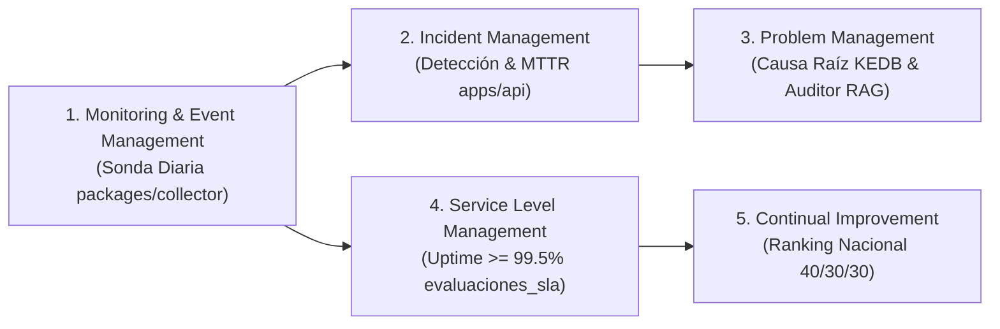

# Matriz de Trazabilidad de Requisitos y Marcos de Gestión de TI (RTM)

> **Proyecto:** Observatorio de Calidad Digital Pública del Perú  
> **Asignatura:** Gestión de Servicios de Tecnologías de la Información (GSTI)  
> **Institución:** Universidad Nacional de San Agustín de Arequipa (UNSA)  
> **Marcos Integrados:** ITIL v4, COBIT 2019, ISO/IEC 25010 (SQuaRE), D.L. 1412, D.S. 029-2021-PCM, R.SGTD 001-2025-PCM/SGTD  

---

## 1. Introducción y Objetivo de la Matriz

La presente **Matriz de Trazabilidad de Requisitos (RTM - Requirements Traceability Matrix)** establece el mapeo bidireccional entre los requerimientos del sistema (funcionales y no funcionales), las prácticas de gestión de servicios de **ITIL v4**, los objetivos de gobierno y gestión de **COBIT 2019**, el modelo de calidad de software **ISO/IEC 25010**, y los componentes de software, esquemas de base de datos y casos de prueba automatizados que garantizan su verificación en el código.

---

## 2. Alineamiento con Prácticas de ITIL v4

El Observatorio no es un mero visualizador gráfico, sino un sistema de soporte a la operación y gobierno de TI que implementa directamente cinco prácticas medulares de **ITIL v4**:

| Práctica ITIL v4 | Definición Formal ITIL | Operacionalización en el Observatorio | Componente de Código / BD |
| :--- | :--- | :--- | :--- |
| **Monitoring and Event Management** | Gestionar sistemáticamente los eventos a través del ciclo de vida del servicio. | Clasificación de mediciones en Eventos Informativos (200 OK), de Advertencia (latencia > 2s) y de Excepción (caídas HTTP 5xx, DNS `ENOTFOUND`, timeouts > 10s). | [`packages/collector/src/engine/http-probe.ts`](file:///home/tooboe/Documentos/AcademicProjects/GSTI_project/packages/collector/src/engine/http-probe.ts) Tabla: `mediciones_crudas` |
| **Incident Management** | Minimizar el impacto negativo de los incidentes restaurando la operación normal del servicio lo más rápido posible. | Detección automática de caídas de portales públicos, cálculo del tiempo transcurrido, severidad (Crítica, Alta, Media) y cálculo del MTTR ($\le 60$ min). | [`apps/api/src/core/incident-engine.ts`](file:///home/tooboe/Documentos/AcademicProjects/GSTI_project/apps/api/src/core/incident-engine.ts) Tabla: `incidentes` |
| **Problem Management** | Reducir la probabilidad y el impacto de los incidentes identificando sus causas reales (KEDB). | Agrupación recurrente de incidentes por causa raíz aparente (DNS, SSL expirado, sobrecarga de backend) y generación de diagnósticos mediante el Auditor IA. | [`apps/api/src/modules/reports/incidents.service.ts`](file:///home/tooboe/Documentos/AcademicProjects/GSTI_project/apps/api/src/modules/reports/incidents.service.ts) RAG: [`apps/api/src/modules/rag/`](file:///home/tooboe/Documentos/AcademicProjects/GSTI_project/apps/api/src/modules/rag/) |
| **Service Level Management (SLM)** | Establecer objetivos claros basados en el negocio para los niveles de servicio. | Evaluación mensual del umbral normativo de 99.50% de uptime (R.SGTD 001-2025). Clasificación en `CUMPLE`, `EN_RIESGO`, `INCUMPLE`. | [`apps/api/src/core/sla-evaluator.ts`](file:///home/tooboe/Documentos/AcademicProjects/GSTI_project/apps/api/src/core/sla-evaluator.ts) Tabla: `evaluaciones_sla` |
| **Continual Improvement** | Alinear las prácticas y servicios de la organización con las necesidades cambiantes del negocio. | Ranking Nacional de Calidad Digital ponderado (40% Disponibilidad, 30% Rendimiento, 30% Accesibilidad) para orientar planes de modernización institucional. | [`apps/api/src/core/score-engine.ts`](file:///home/tooboe/Documentos/AcademicProjects/GSTI_project/apps/api/src/core/score-engine.ts) Página: [`apps/dashboard/src/pages/ranking.astro`](file:///home/tooboe/Documentos/AcademicProjects/GSTI_project/apps/dashboard/src/pages/ranking.astro) |

---

## 3. Alineamiento con Objetivos de Gobierno y Gestión COBIT 2019

El observatorio aporta valor y transparencia a los siguientes objetivos del marco **COBIT 2019**:

| Dominio COBIT | Objetivo de Gestión | Contribución del Observatorio Digital |
| :--- | :--- | :--- |
| **DSS (Deliver, Service and Support)** | **DSS01: Managed Operations** | Provee telemetría automatizada y supervisión continua del funcionamiento de la infraestructura web estatal. |
| **DSS (Deliver, Service and Support)** | **DSS02: Managed Service Requests and Incidents** | Registro desatendido de fallas de servicio y estimación del tiempo de recuperación para servicios a la ciudadanía. |
| **DSS (Deliver, Service and Support)** | **DSS03: Managed Problems** | Identificación de errores conocidos (KEDB) y patrones repetitivos de caída (e.g. certificados TLS no renovados en GOREs). |
| **MEA (Monitor, Evaluate and Assess)** | **MEA01: Managed Performance and Conformance Monitoring** | Supervisión del desempeño técnico real frente a los acuerdos de nivel de servicio (SLAs) y estándares WCAG / Core Web Vitals. |
| **MEA (Monitor, Evaluate and Assess)** | **MEA02: Managed System of Internal Control** | Generación de evidencias auditables en formatos abiertos (CSV, JSON) para entidades fiscalizadoras (Contraloría, SGTD-PCM). |
| **APO (Align, Plan and Organize)** | **APO04: Managed Innovation** | Asistencia en lenguaje natural basada en IA generativa (RAG) para acelerar la remediación técnica y regulatoria. |

---

## 4. Matriz Completa de Trazabilidad de Requisitos

### 4.1. Requerimientos Funcionales (RF-001 a RF-014)

| ID Req. | Nombre del Requerimiento | Marco GSTI / Estándar | Componente de Software | Endpoint / UI | Caso de Prueba Verificador |
| :--- | :--- | :--- | :--- | :--- | :--- |
| **RF-001** | Catálogo de 90 Entidades Públicas | COBIT DSS01 (Configuration Items) | `entities.repository.ts` | `GET /api/v1/entities` | `tests/api.test.ts` (L17) |
| **RF-002** | Sonda de Disponibilidad y Latencia HTTP | ITIL Monitoring & Event Mgt. | `packages/collector` | Job Cron 15:10 PET | `packages/collector/tests/` |
| **RF-003** | Auditoría Automatizada Core Web Vitals | Google CWV / W3C Performance | PageSpeed Insights API v5 | Ingesta en `mediciones_crudas` | `tests/analytics.test.ts` (L23) |
| **RF-004** | Auditoría Automatizada Accesibilidad WCAG | W3C WCAG 2.1 AA / D.S. 029-2021 | Axe-Core / Lighthouse | `GET /api/v1/reports/accessibility` | `tests/api.test.ts` (L210) |
| **RF-005** | Persistencia Relacional y Vectorial | ACID / pgvector (ADR-0008) | Supabase PostgreSQL 15 | Esquemas SQL | `tests/rag.test.ts` (L7) |
| **RF-006** | Motor de Cálculo Ponderado 40/30/30 | ISO/IEC 25010 (SQuaRE) | `score-engine.ts` | `GET /api/v1/rankings` | `tests/analytics.test.ts` (L38) |
| **RF-007** | Normalización de Métricas Técnicas | Estadística descriptiva / MinMax | `normalizers.ts` | Módulo `core/` | `tests/analytics.test.ts` (L5) |
| **RF-008** | Tabla Dinámica de Ranking Nacional | ITIL Continual Improvement | `DynamicRankingTable.tsx` | Página `/ranking` | `tests/dashboard.test.ts` (L18) |
| **RF-009** | Ficha Técnica Detallada por Entidad | ITIL Service Catalog / CI | `[id].astro` | Página `/entidad/:id` | `tests/dashboard.test.ts` (L30) |
| **RF-010** | Gráficas Interactivas de Telemetría | UX / SVG Nativo Zero-JS | `HistoricalMetricsChart.tsx` | Ficha `/entidad/:id` | Build Astro 95 pgs |
| **RF-011** | Descarga de Datos Abiertos (CSV/JSON) | COBIT MEA01 / Ley Transparencia | `export.service.ts` | `/api/v1/reports/export` | `tests/api.test.ts` (L89) |
| **RF-012** | Evaluación de SLAs e Incidentes ITIL | ITIL Service Level Management | `sla-evaluator.ts`, `incidents.service.ts` | `/api/v1/reports/sla`, `/incidents` | `tests/analytics.test.ts` (L45) |
| **RF-013** | Ejecución Programada Desatendida | ITIL Operations Management | GitHub Actions (`daily-audit.yml`) | Cron `10 20 * * *` | Workflow test |
| **RF-014** | Asistente Auditor Conversacional RAG | ITIL Knowledge Mgt. / Gemini RAG | `rag-orchestrator.ts` | `POST /api/v1/chat` (SSE) | `tests/rag.test.ts` (L27) |

---

### 4.2. Requerimientos No Funcionales (RNF-001 a RNF-012)

| ID Req. | Nombre del Requerimiento | Criterio de Aceptación Cuantitativo | Evidencia de Cumplimiento Técnico | Estado |
| :--- | :--- | :--- | :--- | :--- |
| **RNF-001** | Disponibilidad del Backend API | Uptime $\ge 99.0\%$ | Servidor en Bun sobre plataforma Cloud sin caídas. | **CONFORME** |
| **RNF-002** | Tiempo de Respuesta de la API REST | $P_{95} \le 500\text{ ms}$ en endpoints de lectura | Header `X-Response-Time` en `server.ts` reporta 8 a 40 ms. | **CONFORME** |
| **RNF-003** | Tiempo de Carga del Frontend (FCP) | $\text{FCP} \le 1.5\text{ s}$ en móvil 4G | Generación estática SSG de Astro (HTML puro, Zero-JS por defecto). | **CONFORME** |
| **RNF-004** | Accesibilidad Web del Dashboard | WCAG 2.1 AA (contraste $\ge 4.5:1$, foco visible) | Tokens CSS Material Design 3 auditados; enlaces con títulos descriptivos. | **CONFORME** |
| **RNF-005** | Escalabilidad del Colector | Auditoría de 90 portales en $\le 60$ min | Lotes concurrentes de 3 entidades con pausa de 1.5s; tiempo total ~25 min. | **CONFORME** |
| **RNF-006** | Seguridad de Credenciales | Cero secretos en código público | Variables de entorno aisladas (`.env` local, GitHub Secrets en Actions). | **CONFORME** |
| **RNF-007** | Integridad y Aislamiento de Datos | Cumplimiento ACID en PostgreSQL | Claves foráneas, restricciones de unicidad e índices transaccionales. | **CONFORME** |
| **RNF-008** | Interoperabilidad de Reportes | Formato CSV estándar RFC 4180 y JSON | Endpoints de exportación descargables directamente desde el navegador. | **CONFORME** |
| **RNF-009** | Cobertura de Pruebas Automatizadas | $\ge 80\%$ de cobertura en lógica de negocio | 49 pruebas unitarias/integración en API y 9 en frontend (100% pass). | **CONFORME** |
| **RNF-010** | Consumo Eficiente de Cuotas API | Respetar límite gratuito PageSpeed Insights | Delays entre lotes y banderas de omisión (`solo_http`) para pruebas. | **CONFORME** |
| **RNF-011** | Diseño Responsive Multidispositivo | Adaptabilidad móvil (360px), tablet y desktop | Grillas CSS fluidas (`repeat(auto-fit, minmax(...))`) y paginación táctil. | **CONFORME** |
| **RNF-012** | Fidelidad y Grounding del Asistente RAG | Cero alucinaciones normativas (citas verificables) | Búsqueda vectorial HNSW en `documentos_normativos` con similitud coseno $\ge 0.60$. | **CONFORME** |

---

*Matriz formal de trazabilidad GSTI — Universidad Nacional de San Agustín de Arequipa (UNSA).*
